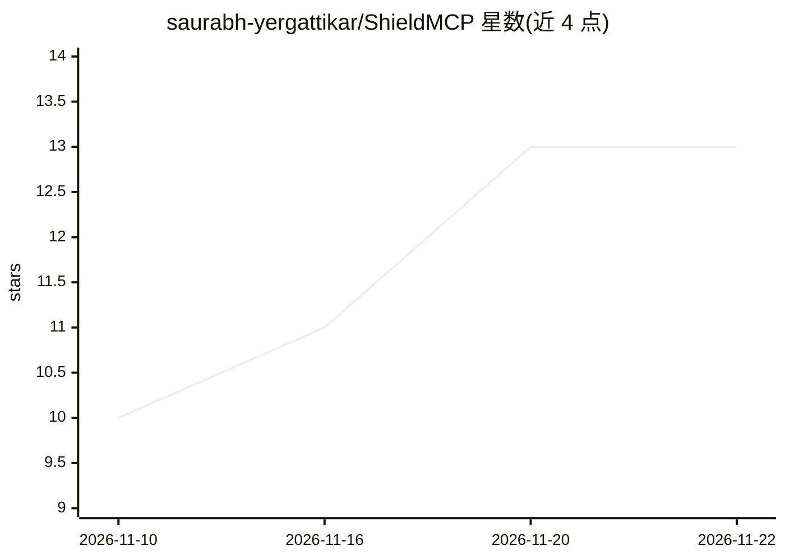

# saurabh-yergattikar/ShieldMCP

⭐ 13 · Python · Apache-2.0 · 推送 2026-11-09 · [GitHub](https://github.com/saurabh-yergattikar/ShieldMCP) · 个人维护

**面向 MCP 的透明安全代理：校验工具元数据、调用与响应**

部署在 agent 与 MCP server 之间的运行时安全层，按三阶段检查：工具描述/哈希完整性、出站参数的 schema 与 SQL/shell/prompt 模式校验、入站响应的注入与隐藏内容分析。以 stdio（newline/Content-Length）或 legacy SSE 透明代理运行，或通过异步 Python API 集成；默认启发式后端本地运行，无需模型下载或 API key，可选本地 DistilBERT 分类器与 llm_judge 后端。作者声明为 alpha 研究框架，Stage 3 只能拦截响应、不能撤销副作用。

## 筛选速览

| 维度 | 判定 | 备注 |
|---|---|---|
| AI 角色 | `ai-ecosystem` | LLM/agent 周边工具 |
| 许可风险 | `permissive` | Apache-2.0 |
| 部署形态 | `library` | 以包/库形式分发 |
| 模型依赖 | local-ok | 支持本地模型 |
| 硬件要求 | — | 无带数字的原话,不猜 |
| 安装摩擦 | `low` | 无编译、无系统依赖或容器化 |
| 成熟度 | `idea` | |

## 能力要点

- 三阶段管线：元数据完整性、参数校验、响应分析
- 默认启发式检测本地运行，无需模型下载或 API key
- 可选本地微调 DistilBERT 分类器与分层检测后端
- CLI 代理与异步 Python API 两种接入方式

## 适用场景

- 为 agent 的 MCP 工具调用加一道运行时安全检查
- 检测工具描述投毒与元数据变更（rug pull）
- 拦截间接 prompt 注入与可疑跨工具调用链

## 场景标签

`网络安全` · 领域:学习与行业

## 证据(README 行号)

> L5: Open-source runtime security at the Model Context Protocol boundary.
> L15: ShieldMCP sits between an agent and its MCP server, checking **tool metadata, outbound arguments, and inbound respo
> L44: |🔌 **Proxy or Python API**|Newline/Content-Length stdio framing, legacy SSE, and an async pipeline|Core API|

## 星数曲线

2026-11-10 10 → 2026-11-22 13（+3）

---
*卡片 v1 · prompt 1.4 · 生成 2026-11-18 · 置信度 high · 依据 README sha `6361b72ed7c4` · [字段定义](../../DATASET.md)*
