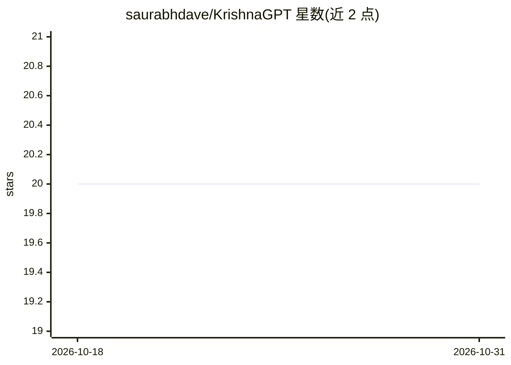

# saurabhdave/KrishnaGPT

⭐ 20 · Swift · 推送 2026-03-24 · [GitHub](https://github.com/saurabhdave/KrishnaGPT) · [官网](https://github.com/saurabhdave/KrishnaGPT) · 个人维护

**iOS 聊天应用：以《薄伽梵歌》视角回答问题并附诗节引用**

面向终端用户的 SwiftUI iOS 应用，基于 OpenAI Responses API（流式输出）构建对话界面，以《薄伽梵歌》教义视角回答用户提问，每条回答附相关章节诗节引用。支持 6 种语言（英/印地/法/德/中/西）、相机文字扫描提问、会话历史保留（16K 字符/100 条上限）与 VoiceOver 无障碍。需要 Xcode 16+、iOS 18+ 与用户自备 OpenAI API key，通过 xcconfig 配置；架构采用 MVVM 与 @Observable，默认模型 gpt-4.1-mini。

## 筛选速览

| 维度 | 判定 | 备注 |
|---|---|---|
| AI 角色 | `ai-native` | 本体是模型或模型工具 |
| 许可风险 | `none` | — |
| 部署形态 | `None` |  |
| 模型依赖 | — | README 未给出锁定关系 |
| 硬件要求 | — | 无带数字的原话,不猜 |
| 安装摩擦 | `low` | 无编译、无系统依赖或容器化 |
| 成熟度 | — | 结构信号不足 |

## 能力要点

- OpenAI Responses API 流式响应，逐 token 实时显示
- 每条回答附《薄伽梵歌》章节诗节引用
- 6 种语言切换，会话内切语言保留历史
- 相机扫描实体文字提问与完整 VoiceOver 无障碍支持

## 适用场景

- 以《薄伽梵歌》视角获得带诗节出处的心灵/人生问题回答
- 扫描实体文本并就其内容提问
- 用母语（含印地语、中文等）进行灵性问答

## 场景标签

`聊天机器人` · 领域:对话与助手

## 证据(README 行号)

> L3: **Ask any question. Receive wisdom from the Bhagavad Gita — with verse citations — in your language of choice.**
> L19: |**Streaming responses**|Tokens appear in real time as Krishna speaks|

## 星数曲线

2026-10-18 20 → 2026-10-31 20（+0）

---
*卡片 v1 · prompt 1.4 · 生成 2026-10-28 · 置信度 high · 依据 README sha `4811957f45fd` · [字段定义](../../DATASET.md)*
