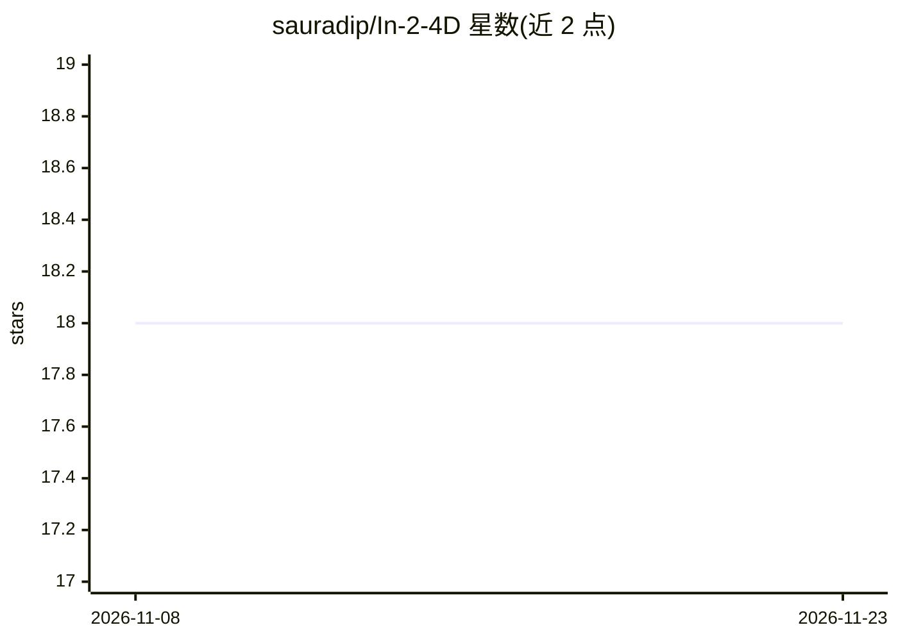

# sauradip/In-2-4D

⭐ 18 · Python · 推送 2026-11-01 · [GitHub](https://github.com/sauradip/In-2-4D) · [官网](https://in-2-4d.github.io/) · 组织维护

**从两张单视图图像生成 4D 运动的 PyTorch 研究实现**

SIGGRAPH ASIA 2025 论文 In-2-4D 的官方 PyTorch 实现：给定同一物体起始与结束两个运动状态的单视图图像，先用视频插值模型预测运动，经层级关键帧选取后对每个片段用 Gaussian Splatting 构建 3D 表征，通过变形场转为动态高斯，并合并各段 4D 运动输出新视角视频。代码以 git clone 源码方式安装，第三方依赖以 git submodule 固定版本并打补丁，分三个 conda 环境运行，需下载多个预训练权重。面向 4D 生成方向的科研人员。

## 筛选速览

| 维度 | 判定 | 备注 |
|---|---|---|
| AI 角色 | `ai-native` | 本体是模型或模型工具 |
| 许可风险 | `none` | — |
| 部署形态 | `None` |  |
| 模型依赖 | — | README 未给出锁定关系 |
| 硬件要求 | — | 无带数字的原话,不猜 |
| 安装摩擦 | `low` | 无编译、无系统依赖或容器化 |
| 成熟度 | — | 结构信号不足 |

## 能力要点

- 两图输入→4D（3D+运动）生成的完整流水线（s0-s9）
- Gaussian Splatting 表征与变形场驱动的动态高斯
- 支持 4-step 蒸馏视频模型加速推理与 LTX-Video 骨干
- 输出多视角图像、4D 高斯与新视角渲染视频

## 适用场景

- 我需要从物体的两张照片补全中间的 3D 运动过程
- 做 4D 生成或动态高斯相关研究时复现论文方法
- 生成物体旋转等新视角视频

## 场景标签

`视频生成` `图像生成` `科研工具` · 领域:内容生成

## 证据(README 行号)

> L1: In-2-4D: Inbetweening from Two Single-View Images to 4D Generation
> L17: We propose a new problem, In-2-4D, for generative 4D (i.e., 3D + motion) inbetweening from a minimalistic input set
> L43: 1. Generate the 4D object (all steps, s0-s9):

## 星数曲线

2026-11-08 18 → 2026-11-23 18（+0）

---
*卡片 v1 · prompt 1.4 · 生成 2026-11-18 · 置信度 high · 依据 README sha `f6e405177950` · [字段定义](../../DATASET.md)*
