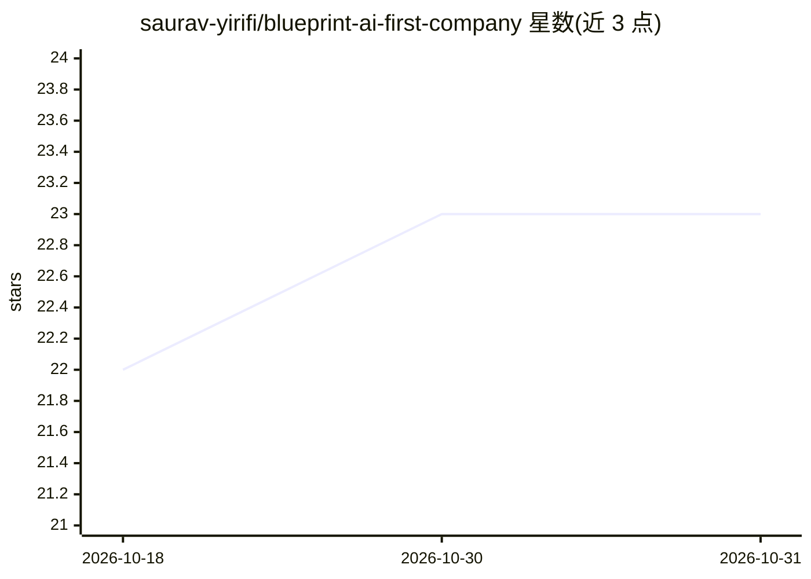

# saurav-yirifi/blueprint-ai-first-company

⭐ 23 · Python · NOASSERTION · 推送 2026-09-27 · [GitHub](https://github.com/saurav-yirifi/blueprint-ai-first-company) · [官网](https://aiblueprint.saurav.ai) · 个人维护

**AI-first 公司方法论开源书：81K 字 12 章 + 框架与代码配套**

一本以 CC BY-NC-SA 4.0 发布的开源书籍《Blueprint for an AI-First Company》及配套仓库：正文 81,000+ 字、12 章、775 条带 URL 引用；仓库额外提供 20 个决策框架、14 个 Python 代码示例（agent 模式、AI 网关、统一认证、可观测性、CI AI 审查等）、7 份清单、6 份指南、4 套工作流及 57 个 AI 写作流程文件。面向评估或推进 AI-first 转型的创始人与团队；书的制作本身采用基于 Claude Code、Perplexity 与 Obsidian 的多 agent 写作系统，全部提示词与脚本开源可研究。

## 筛选速览

| 维度 | 判定 | 备注 |
|---|---|---|
| AI 角色 | `ai-knowledge` | 知识聚合/清单类 |
| 许可风险 | `none` | NOASSERTION |
| 部署形态 | `None` |  |
| 模型依赖 | — | README 未给出锁定关系 |
| 硬件要求 | — | 无带数字的原话,不猜 |
| 安装摩擦 | `low` | 无编译、无系统依赖或容器化 |
| 成熟度 | — | 结构信号不足 |

## 能力要点

- 81,000+ 字 12 章正文，775 条带 URL 的行内引用
- 20 个决策框架 + 14 个 Python 代码示例（Chat Agent、Agent Hub、AI Gateway 等）
- 完整公开的多 agent AI 写作系统：14 个 Claude Code agent skills、180+ Perplexity 研究提示词、17 个 Python 脚本
- 7 份清单、6 份指南、4 套工作流覆盖就绪评估到治理审计

## 适用场景

- 评估本公司处于 AI-first 与 AI-enabled 光谱的哪个位置
- 按框架和代码示例搭建 agent 架构与 AI 网关
- 研究一套实际产出 81K 字书籍的多 agent 写作系统
- 为团队制定 90 天 AI 熟练度提升计划

## 场景标签

`教程课程` `提示工程` · 领域:Agent 开发

## 证据(README 行号)

> L72: ## About the Book
> L121: 20 decision frameworks extracted from the book, each with context on when and how to use it.
> L159: 14 working examples in Python covering agent patterns, infrastructure components, prompt templates, and CI/CD conf

## 星数曲线

2026-10-18 22 → 2026-10-31 23（+1）

---
*卡片 v1 · prompt 1.4 · 生成 2026-10-27 · 置信度 high · 依据 README sha `cc815a230e96` · [字段定义](../../DATASET.md)*
