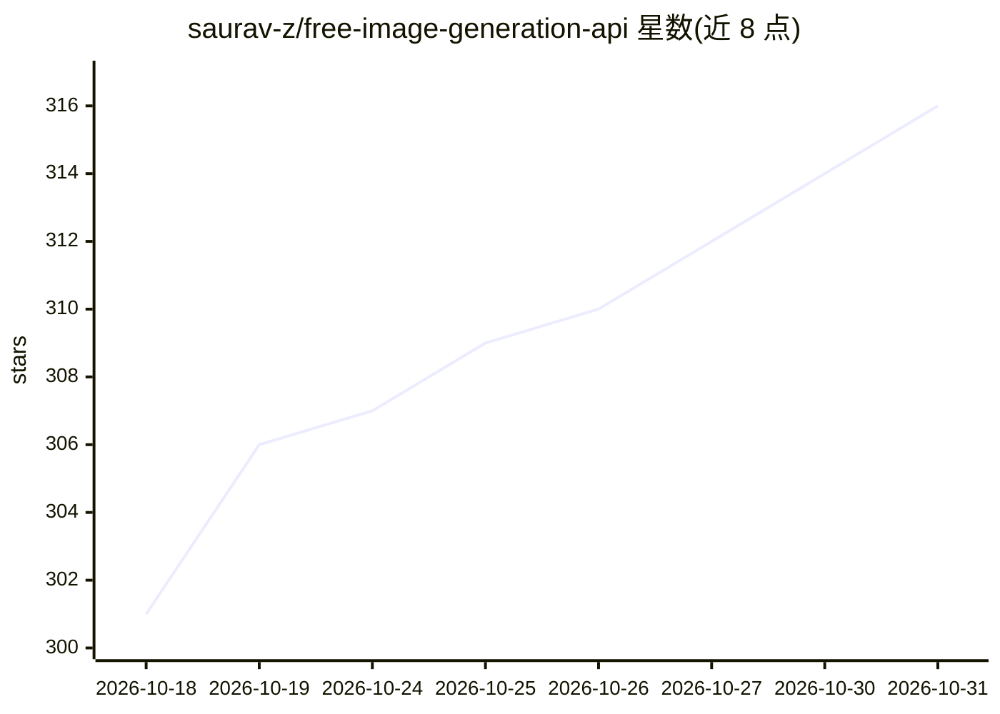

# saurav-z/free-image-generation-api

⭐ 316 · HTML · 推送 2026-03-13 · [GitHub](https://github.com/saurav-z/free-image-generation-api) · [官网](https://youtu.be/VliEpQl06pE) · 个人维护

**部署在 Cloudflare Workers 上的免费文生图 API 模板**

提供一个 worker.js 文件与部署指引：用户在 Cloudflare Workers 上创建 Worker、粘贴代码、设置 API_KEY 环境变量并绑定 Workers AI 服务后，即可获得一个通过 HTTP POST 接收 prompt、返回生成图片的 API 端点，使用 Cloudflare Workers AI 免费额度（README 称每日 100,000 次调用），默认模型为 Stable Diffusion XL，可在 worker.js 中更换模型。面向不想自己搭建推理服务的开发者与使用者，仅支持 Cloudflare 平台部署。

## 筛选速览

| 维度 | 判定 | 备注 |
|---|---|---|
| AI 角色 | `ai-native` | 本体是模型或模型工具 |
| 许可风险 | `none` | — |
| 部署形态 | `None` |  |
| 模型依赖 | — | README 未给出锁定关系 |
| 硬件要求 | — | 无带数字的原话,不猜 |
| 安装摩擦 | `low` | 无编译、无系统依赖或容器化 |
| 成熟度 | — | 结构信号不足 |

## 能力要点

- 单个 worker.js 文件部署文生图 API 端点
- 通过 API_KEY 环境变量做 Bearer 认证
- 依赖 Cloudflare Workers AI 免费额度（README 称 10 万次/天）
- 默认使用 Stable Diffusion XL，可在代码中更换模型

## 适用场景

- 快速自建一个文本生成图片的 HTTP API
- 利用 Cloudflare 免费额度低成本获得文生图服务
- 为原型项目接入图像生成能力

## 场景标签

`图像生成` · 领域:内容生成

## 证据(README 行号)

> L20: - 📤 You deploy a Cloudflare Worker using the provided `worker.js` file
> L23: - 🤖 The Worker uses Cloudflare's free AI models to generate images
> L71: curl -X POST https://<your-worker-name>.<your-subdomain>.workers.dev \

## 星数曲线

2026-10-18 301 → 2026-10-31 316（+15）

---
*卡片 v1 · prompt 1.4 · 生成 2026-10-21 · 置信度 high · 依据 README sha `77279fdbffa6` · [字段定义](../../DATASET.md)*
