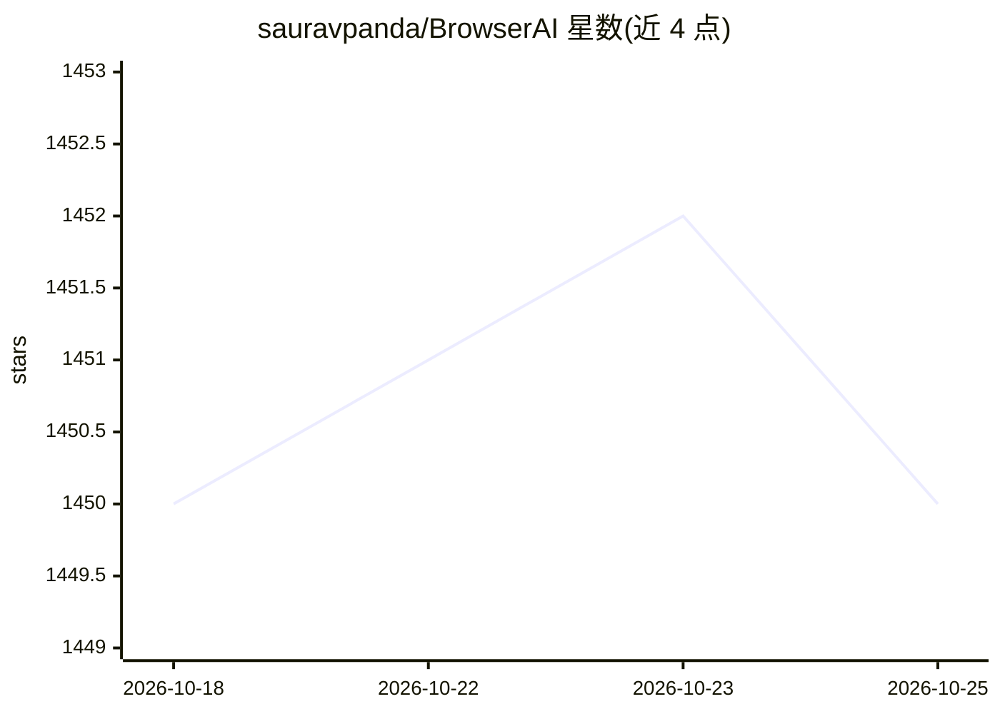

# sauravpanda/BrowserAI

⭐ 1,450 · TypeScript · MIT · 推送 2026-07-21 · [GitHub](https://github.com/sauravpanda/BrowserAI) · [官网](https://browserai.dev) · 个人维护

**在浏览器内本地运行 LLM、语音识别与 TTS 的 JS SDK**

面向 Web 开发者的 JavaScript/TypeScript 库，通过 WebGPU 在浏览器本地运行多种模型：文本生成（Llama-3.2、Qwen、DeepSeek-R1-Distill 等）、语音识别（Whisper 系列）、文本转语音（Kokoro 82M）与音频源分离（Demucs）。支持 MLC、Transformers.js、Flare（WASM 运行 GGUF）、Demucs 四种引擎切换，提供结构化 JSON 输出、Web Worker 非阻塞推理与内置对话/向量存储。初始下载后可离线运行，要求支持 WebGPU 的现代浏览器（Chrome/Edge 113+），shader-f16 模型需硬件支持 16 位浮点。

## 筛选速览

| 维度 | 判定 | 备注 |
|---|---|---|
| AI 角色 | `ai-ecosystem` | LLM/agent 周边工具 |
| 许可风险 | `permissive` | MIT |
| 部署形态 | `library` | 以包/库形式分发 |
| 模型依赖 | — | README 未给出锁定关系 |
| 硬件要求 | — | 无带数字的原话,不猜 |
| 安装摩擦 | `low` | 无编译、无系统依赖或容器化 |
| 成熟度 | — | 结构信号不足 |

## 能力要点

- 浏览器内 WebGPU 加速运行 LLM，无需服务器
- 支持 MLC / Transformers / Flare(GGUF via WASM) / Demucs 四引擎切换
- 覆盖文本生成、Whisper 语音识别、Kokoro TTS、音频源分离
- JSON schema 结构化输出与 Web Worker 非阻塞推理

## 适用场景

- 在 Web 应用中嵌入完全本地、隐私优先的 AI 对话功能
- 为网站添加离线可用的语音识别或文字转语音
- 在浏览器中做音乐人声/鼓/贝斯分离处理

## 场景标签

`推理引擎` `语音合成` `语音识别` · 领域:内容生成

## 证据(README 行号)

> L29: - 🎯 **Developer Friendly**: Simple sdk with multiple engine support
> L42: - 🎯 Run AI models directly in the browser - no server required!
> L44: - 🔄 Seamless switching between MLC, Transformers, Flare, and Demucs engines

## 星数曲线

2026-10-18 1,450 → 2026-10-25 1,450（+0）

---
*卡片 v1 · prompt 1.4 · 生成 2026-10-21 · 置信度 high · 依据 README sha `91f1edb8d924` · [字段定义](../../DATASET.md)*
