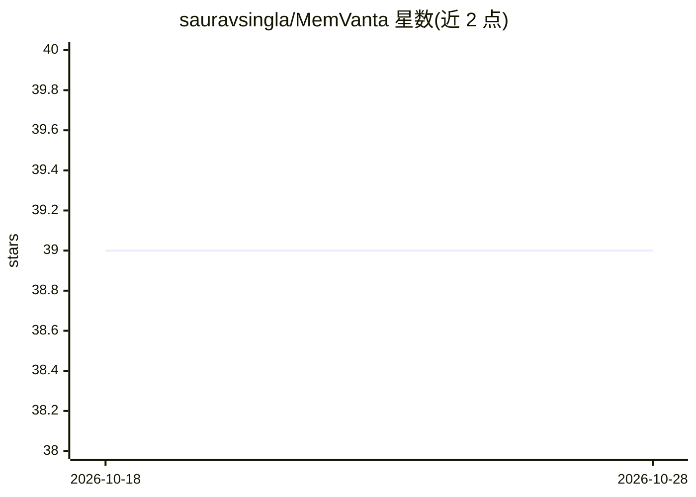

# sauravsingla/MemVanta

⭐ 39 · C++ · Apache-2.0 · 推送 2026-10-09 · [GitHub](https://github.com/sauravsingla/MemVanta) · [官网](https://sauravsingla.github.io/MemVanta/) · 个人维护

**低内存 C++20 CPU 推理运行时：跑量化 GGUF Llama 模型**

面向 RAM 受限的 CPU 环境的本地 LLM 推理运行时：以 mmap 按需映射 GGUF 权重、分页 KV cache、Q4/Q8 量化 CPU 内核与有界自适应预取，目标是降低常驻内存而非吞吐。训练模型执行目前仅支持 llama 架构 GGUF，有 7B 级验证，项目自述为研究/工程原型。提供可复现的与固定版本 llama.cpp 的同机 A/B 内存与吞吐基准（峰值 RSS 降低 47.54%，吞吐低于对方）。发布形式含 PyPI manylinux wheel、Linux x86-64 预编译包与源码构建。

## 筛选速览

| 维度 | 判定 | 备注 |
|---|---|---|
| AI 角色 | `ai-ecosystem` | LLM/agent 周边工具 |
| 许可风险 | `permissive` | Apache-2.0 |
| 部署形态 | `library` | 以包/库形式分发 |
| 模型依赖 | — | README 未给出锁定关系 |
| 硬件要求 | — | 无带数字的原话,不猜 |
| 安装摩擦 | `medium` | 含编译或系统依赖之一 |
| 成熟度 | `idea` | |

## 能力要点

- mmap 权重访问 + 分页 KV cache + Q4/Q8 内核的低内存推理路径
- 与固定版本 llama.cpp 的可复现 A/B 内存/吞吐基准
- PyPI manylinux wheel 与预编译 Linux x86-64 发行包
- 含 ASan/TSan、模糊测试、ARM64 QEMU 等验证通道

## 适用场景

- 在小内存开发机或边缘设备上运行量化 Llama GGUF 模型
- 研究内存受限下的本地推理内存策略
- 复现与对比 CPU LLM 推理的内存占用测量

## 场景标签

`推理引擎` · 领域:训练与推理

## 证据(README 行号)

> L6: **Low-memory C++20 LLM inference runtime for quantized GGUF models on CPU.**
> L8: MemVanta is a memory-first local LLM runtime for running quantized Llama-family GGUF models on CPUs with limited RAM
> L16: It is designed for experiments where RAM pressure matters more than maximum token throughput, including constrained

## 星数曲线

2026-10-18 39 → 2026-10-28 39（+0）

---
*卡片 v1 · prompt 1.4 · 生成 2026-10-25 · 置信度 high · 依据 README sha `0489c76cabd7` · [字段定义](../../DATASET.md)*
