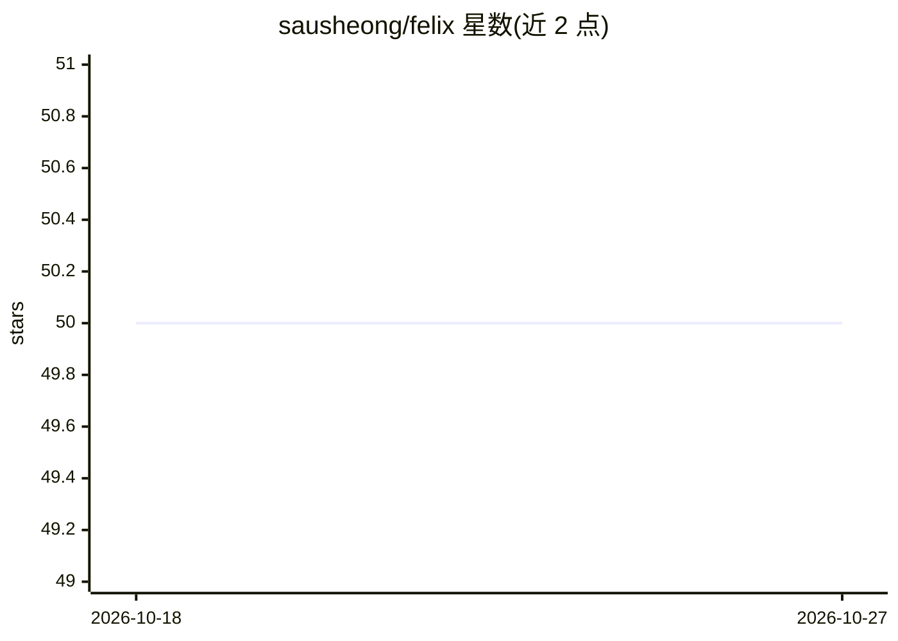

# sausheong/felix

⭐ 50 · Go · 推送 2026-08-03 · [GitHub](https://github.com/sausheong/felix) · 个人维护

**自托管单二进制 AI agent 网关，多 LLM 接入与本地运行**

用 Go 编写的自托管 AI agent 网关，以单一二进制运行于本机。通过 CLI 或网页聊天连接 Claude、GPT、Gemini、Qwen、DeepSeek、Ollama 及任意 OpenAI 兼容端点，内置 Ollama 运行时可完全离线使用（无 API key）。提供进程内工具注册表与远程 MCP 服务器客户端，持久化记忆（BM25/可选向量检索）、SQLite 知识图谱、子代理、Cron 任务。状态以纯文件存于 ~/.felix/，默认仅绑定 localhost。macOS 提供签名 .pkg 安装包，Linux/Windows 从源码构建。

## 筛选速览

| 维度 | 判定 | 备注 |
|---|---|---|
| AI 角色 | `ai-ecosystem` | LLM/agent 周边工具 |
| 许可风险 | `none` | — |
| 部署形态 | `desktop` | 安装包/桌面程序 |
| 模型依赖 | local-ok | 支持本地模型 |
| 硬件要求 | — | 无带数字的原话,不猜 |
| 安装摩擦 | `medium` | 含编译或系统依赖之一 |
| 成熟度 | — | 结构信号不足 |

## 能力要点

- 单一二进制、无运行时依赖，内置 Ollama 支持零 API key 离线运行
- 多提供商接入：Anthropic/OpenAI/Gemini/Qwen 原生 API 及 OpenAI 兼容端点
- MCP 客户端（Streamable-HTTP/stdio，OAuth2）与子代理委托
- 持久记忆与 SQLite 知识图谱，会话 JSONL 追加式存储与智能压缩

## 适用场景

- 在本机运行一个多模型 AI agent 网关，经网页或 CLI 聊天使用
- 无 API key 场景下用内置 Ollama 跑本地模型 agent
- 通过 MCP 服务器扩展 agent 能力并管理多 agent 配置

## 场景标签

`模型网关` `AI 助手` · 领域:Agent 开发

## 证据(README 行号)

> L5: A self-hosted AI agent gateway written in Go. Single binary, low memory, runs entirely on your own machine.
> L7: Felix connects you (via CLI or web chat) to LLMs — Claude, GPT, Gemini, Qwen, Ollama, or any OpenAI-compatible endpo
> L167: Felix supports multiple providers simultaneously. Each is defined in the `providers` block with a unique name and 

## 星数曲线

2026-10-18 50 → 2026-10-27 50（+0）

---
*卡片 v1 · prompt 1.4 · 生成 2026-10-24 · 置信度 high · 依据 README sha `a7f94891572d` · [字段定义](../../DATASET.md)*
