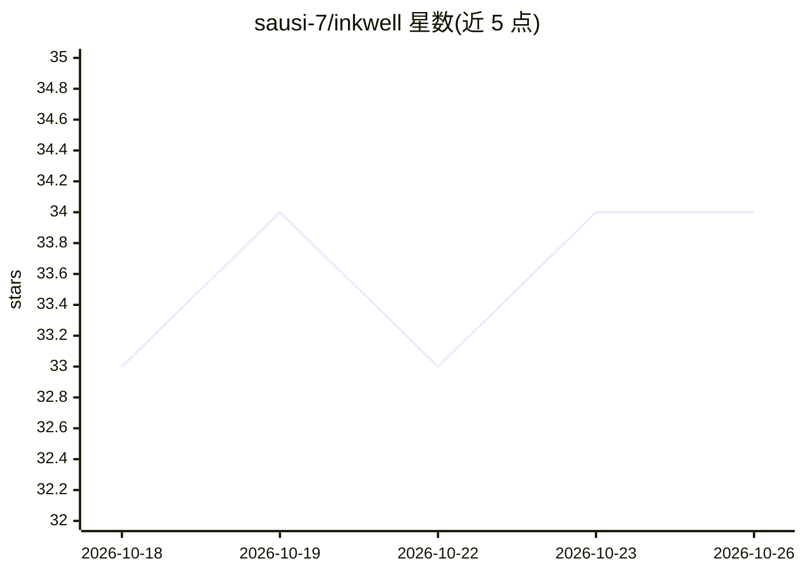

# sausi-7/inkwell

⭐ 34 · Python · MIT · 推送 2026-06-20 · [GitHub](https://github.com/sausi-7/inkwell) · [官网](https://github.com/sausi-7/inkwell) · 个人维护

**自托管 BYOK 外联情报工具：免费扫描社区、按需用你的 LLM 生成人声回复**

面向创业者/独立开发者的外联线索工具。分两阶段：扫描阶段用规则启发式（无 LLM token）扫描 Reddit 等社区，按关键词、分数、时效等过滤并给出 Yes/Maybe/No 参与度评分，导出 CSV 或 Google Sheets；起草阶段 BYOK，用户点击 Draft 后由浏览器中存储的自有 LLM key 经 LiteLLM 调用任意模型，按 YAML 人设文件生成个人语气的回复。自托管单用户，服务器仅绑定 127.0.0.1，支持断点续扫。需 Google OAuth 与 LLM API key。

## 筛选速览

| 维度 | 判定 | 备注 |
|---|---|---|
| AI 角色 | `ai-native` | 本体是模型或模型工具 |
| 许可风险 | `permissive` | MIT |
| 部署形态 | `library` | 以包/库形式分发 |
| 模型依赖 | local-ok | 支持本地模型 |
| 硬件要求 | — | 无带数字的原话,不猜 |
| 安装摩擦 | `low` | 无编译、无系统依赖或容器化 |
| 成熟度 | — | 结构信号不足 |

## 能力要点

- 扫描阶段纯规则启发式，不消耗 LLM token，评分确定性可审计
- BYOK：LLM key 存浏览器 localStorage，仅起草请求时经 X-LLM-Key 传递给 LiteLLM
- YAML 人设文件定义语气，生成个人化回复而非通用模板
- 支持任意 LiteLLM 兼容模型（OpenAI、Claude、Ollama、Gemini 等）

## 适用场景

- 扫描 Reddit 子版寻找公开表达问题、可参与互动的潜在用户
- 用自己的人设和 API key 按需生成个人语气的回复草稿
- 导出线索到 Google Sheets 做外联跟进

## 场景标签

`网页抓取` `AI 写作` · 领域:效率与自动化

## 证据(README 行号)

> L18: **Voice drafting is BYOK, on demand.** When you see a signal worth replying to, click **Draft** and Inkwell uses *y
> L26: - **$0 until you draft.** Every other "AI outreach" tool bills you to scan. We don't spend a token until you ask fo

## 星数曲线

2026-10-18 33 → 2026-10-26 34（+1）

---
*卡片 v1 · prompt 1.4 · 生成 2026-10-25 · 置信度 high · 依据 README sha `f1b9e75183b8` · [字段定义](../../DATASET.md)*
