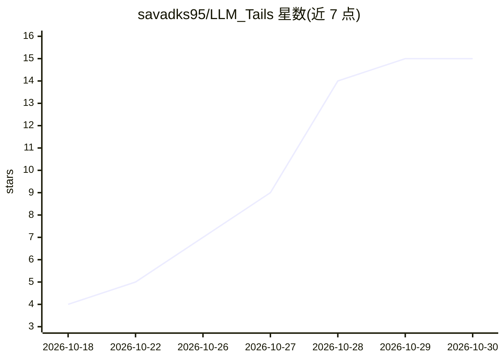

# savadks95/LLM_Tails

⭐ 15 · JavaScript · MIT · 推送 2026-10-28 · [GitHub](https://github.com/savadks95/LLM_Tails) · 个人维护

**给 AI 编程 agent 的纪律化编码模式：提示词+钩子+技能包**

面向 Claude Code、Cursor、Copilot、Codex 等编码 agent 的安装包：由提示词（skills/tails/SKILL.md、AGENTS.md）、生命周期钩子与斜杠命令组成，向 agent 注入四条纪律——先理解再改（自动生成 10 语言代码库地图）、最小修改、反幻觉（用前验证 API/路径，标记 [verified]）、遵循项目既有惯例。附带三层持久 wiki（BM25 检索）、会话记忆与跨 agent 交接文件。合并自 Ponytail 与 Karpathy 的 LLM Wiki 两个项目，新增反幻觉与一致性两支柱。

## 筛选速览

| 维度 | 判定 | 备注 |
|---|---|---|
| AI 角色 | `ai-ecosystem` | LLM/agent 周边工具 |
| 许可风险 | `permissive` | MIT |
| 部署形态 | `library` | 以包/库形式分发 |
| 模型依赖 | — | README 未给出锁定关系 |
| 硬件要求 | — | 无带数字的原话,不猜 |
| 安装摩擦 | `low` | 无编译、无系统依赖或容器化 |
| 成熟度 | — | 结构信号不足 |

## 能力要点

- 四支柱纪律：理解优先、最小修改、反幻觉验证、一致性强制，分 lite/full/ultra 三档强度
- 零依赖正则式代码库地图（hooks/tails-map.js，会话启动自动注入）
- 三层持久 wiki（raw/wiki/log）+ BM25 检索 + 跨 agent handoff.md 交接
- 会话记忆（密钥掩码、压缩后恢复）与可选大文件读取守卫、守卫模式规则

## 适用场景

- 让 AI 编码 agent 修复 bug 时先读代码库 wiki 与调用链再动手
- 在团队内跨不同 AI agent 保留会话决策与交接记录
- 审查全仓质量：幻觉风险、冗余、一致性与 wiki 健康度

## 场景标签

`提示工程` `Agent 记忆` · 领域:Agent 开发

## 证据(README 行号)

> L35: LLM_Tails is a **disciplined AI coding mode** — a set of prompts, lifecycle hooks, and skills you install into your
> L83: LLM_Tails is one prompt: `skills/tails/SKILL.md`. The compact version, for agents that read a rules file, is `AGENT

## 星数曲线

2026-10-18 4 → 2026-10-30 15（+11）

---
*卡片 v1 · prompt 1.4 · 生成 2026-10-30 · 置信度 mid · 依据 README sha `aa7b14f7179d` · [字段定义](../../DATASET.md)*
