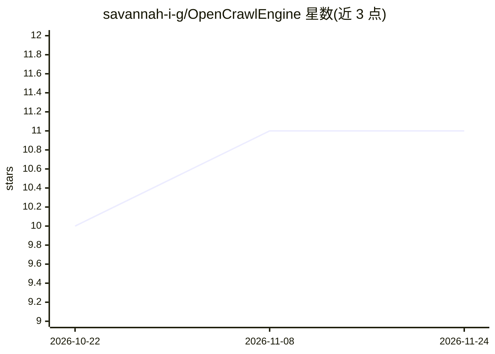

# savannah-i-g/OpenCrawlEngine

⭐ 11 · C++ · MIT · 推送 2026-06-22 · [GitHub](https://github.com/savannah-i-g/OpenCrawlEngine) · 个人维护

**本地单人 RPG 引擎：语言模型担任游戏主持人**

在本地运行的单人角色扮演游戏引擎，通过用户提供的 OpenAI 兼容端点调用语言模型担任游戏主持人，以结构化工具调用叙述并驱动世界。自带确定性规则引擎，覆盖属性、装备、回合制战斗、技能检定、升级、阵营与世界状态；角色与战役存于本地 SQLite 数据库，界面用 Dear ImGui 构建，无服务器、账号系统或遥测。提供 Linux AppImage 与 Debian 安装包，也可从源码构建。

## 筛选速览

| 维度 | 判定 | 备注 |
|---|---|---|
| AI 角色 | `ai-native` | 本体是模型或模型工具 |
| 许可风险 | `permissive` | MIT |
| 部署形态 | `desktop` | 安装包/桌面程序 |
| 模型依赖 | — | README 未给出锁定关系 |
| 硬件要求 | — | 无带数字的原话,不猜 |
| 安装摩擦 | `medium` | 含编译或系统依赖之一 |
| 成熟度 | — | 结构信号不足 |

## 能力要点

- 语言模型游戏主持人通过结构化工具调用驱动世界
- 确定性规则引擎：回合制战斗、技能检定、升级、阵营等
- 本地 SQLite 存储多战役并支持续玩
- 支持任意 OpenAI 兼容端点（如 OpenRouter）

## 适用场景

- 在本地与语言模型主持人进行单人文字角色扮演
- 自建端点/自选模型驱动 RPG 世界叙述
- 离线保存并续玩多个自定义战役

## 场景标签

 · 领域:游戏/桌面应用

## 证据(README 行号)

> L7: OpenCrawlEngine is a local, single-player role-playing game engine driven by a
> L8: language-model game master. It runs on your machine, talks to an OpenAI-compatible
> L15: - A language-model game master that narrates and drives the world through

## 星数曲线

2026-10-22 10 → 2026-11-24 11（+1）

---
*卡片 v1 · prompt 1.4 · 生成 2026-11-18 · 置信度 high · 依据 README sha `02f672c53a63` · [字段定义](../../DATASET.md)*
