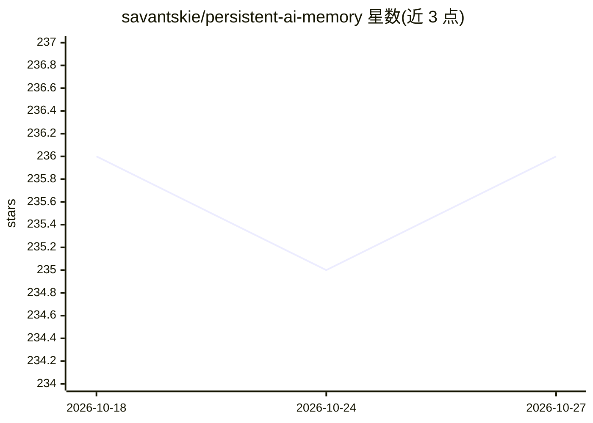

# savantskie/persistent-ai-memory

⭐ 236 · Python · MIT · 推送 2026-09-20 · [GitHub](https://github.com/savantskie/persistent-ai-memory) · 个人维护

**给 AI 助手的本地持久记忆系统：SQLite 存储与语义检索**

面向 OpenWebUI、LM Studio、VS Code 及 MCP 兼容助手的持久记忆层：以五个 SQLite 数据库分别存储对话、长期记忆、日程、工具调用日志与开发上下文，用向量嵌入做语义检索与相关性评分，LLM 驱动记忆抽取、去重与重要性重排。提供 OpenWebUI 插件（主部署方式）、MCP Server 与独立 Python 库三种接入方式；嵌入服务可选 Ollama、LM Studio 或 OpenAI。所有记忆操作要求 user_id 与 model_id 以实现多用户隔离。Python 3.8+，MIT 许可。

## 筛选速览

| 维度 | 判定 | 备注 |
|---|---|---|
| AI 角色 | `ai-ecosystem` | LLM/agent 周边工具 |
| 许可风险 | `permissive` | MIT |
| 部署形态 | `library` | 以包/库形式分发 |
| 模型依赖 | local-ok | 支持本地模型 |
| 硬件要求 | — | 无带数字的原话,不猜 |
| 安装摩擦 | `low` | 无编译、无系统依赖或容器化 |
| 成熟度 | — | 结构信号不足 |

## 能力要点

- 五个专用 SQLite 数据库分类存储对话/记忆/日程/工具日志/项目上下文
- LLM 驱动的记忆抽取、语义去重与重要性动态重排
- OpenWebUI 插件、MCP Server、独立库三种接入方式
- user_id/model_id 强制隔离的多用户安全模式

## 适用场景

- 让 OpenWebUI 或 MCP 助手在对话间保留和检索长期记忆
- 为多个用户/多个模型维护相互隔离的记忆库
- 记录并分析 AI 工具调用历史与使用模式

## 场景标签

`Agent 记忆` · 领域:Agent 开发

## 证据(README 行号)

> L98: **Persistent AI Memory** provides sophisticated memory management for AI assistants:
> L107: - 📱 **Multi-Platform Support** - Works with OpenWebUI (primary), LM Studio, VS Code, and any MCP-compatible assist
> L230: ### 2. MCP Server (Alternative Platforms)

## 星数曲线

2026-10-18 236 → 2026-10-27 236（+0）

---
*卡片 v1 · prompt 1.4 · 生成 2026-10-22 · 置信度 high · 依据 README sha `9e1345dda04b` · [字段定义](../../DATASET.md)*
