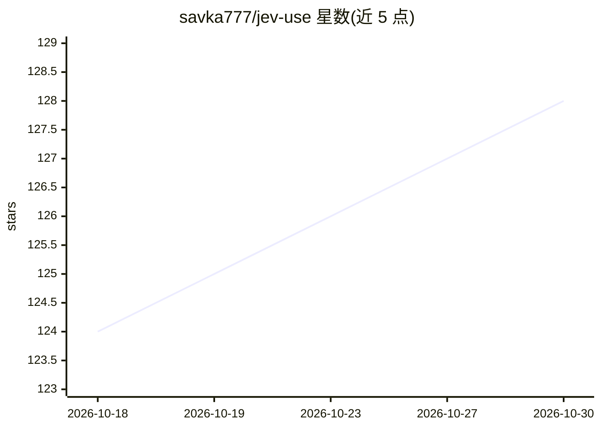

# savka777/jev-use

⭐ 128 · Swift · MIT · 推送 2026-09-21 · [GitHub](https://github.com/savka777/jev-use) · 个人维护

**macOS 语音/文字操控电脑的 computer-use 工具**

面向 macOS 用户的语音与文字电脑操控应用：按住快捷键说出指令或免持唤醒（"Hey Jev"），由 Jev 云端模型选取下一步屏幕操作并执行。核心机制是通过 Accessibility 树读取屏幕元素（无截图、无视觉模型），每步循环约 0.3–1.5 秒；低置信度或破坏性操作会停下询问。语音识别使用 Apple Speech，需 macOS 14.2+ 与 Xcode 从源码构建，并保存 TypeSafe API key。

## 筛选速览

| 维度 | 判定 | 备注 |
|---|---|---|
| AI 角色 | `ai-native` | 本体是模型或模型工具 |
| 许可风险 | `permissive` | MIT |
| 部署形态 | `None` |  |
| 模型依赖 | — | README 未给出锁定关系 |
| 硬件要求 | — | 无带数字的原话,不猜 |
| 安装摩擦 | `low` | 无编译、无系统依赖或容器化 |
| 成熟度 | — | 结构信号不足 |

## 能力要点

- 通过 Accessibility 树读取屏幕，不使用截图与视觉模型
- 支持按住说话、免持模式与 "Hey Jev" 唤醒词
- 每步约 0.3–1.5 秒的读-选-做-查循环
- 低置信度与破坏性操作停止并询问

## 适用场景

- 用语音指令操作 Mac 应用、浏览器与窗口
- 免持连续下达多条命令（如批量打开标签页、平铺窗口）
- 通过菜单栏项目用一句话完成保存/新建等操作

## 场景标签

`GUI 自动化` · 领域:效率与自动化

## 证据(README 行号)

> L5: Voice and typed computer use for macOS. You say what you want. Jev picks the next on-screen action. macOS performs i
> L49: 2. **Choose.** One request to Jev (`jev-latest`): the goal, the numbered targets, the last ten actions and their ef

## 星数曲线

2026-10-18 124 → 2026-10-30 128（+4）

---
*卡片 v1 · prompt 1.4 · 生成 2026-10-23 · 置信度 high · 依据 README sha `b89e1492d4c2` · [字段定义](../../DATASET.md)*
