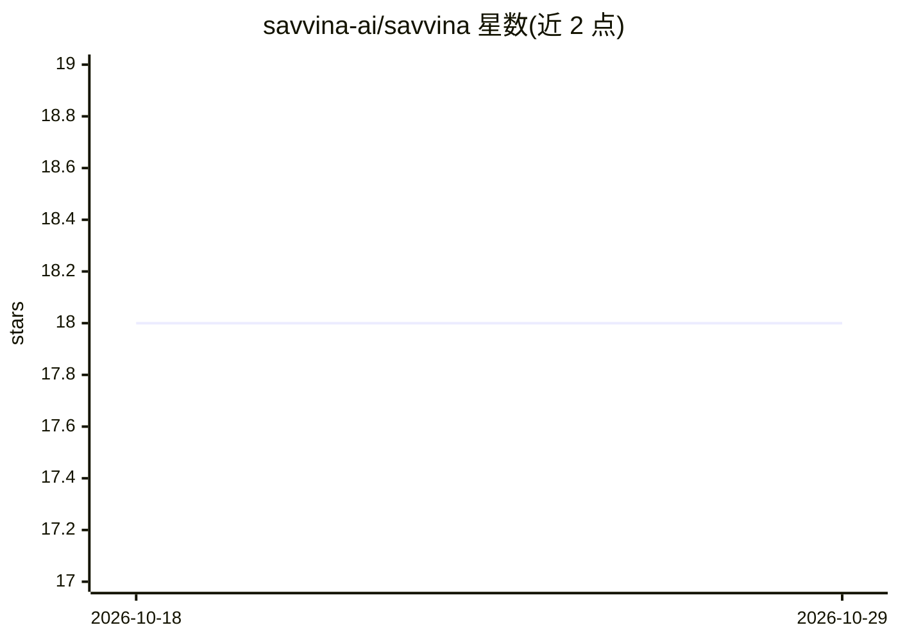

# savvina-ai/savvina

⭐ 18 · Python · NOASSERTION · 推送 2026-10-26 · [GitHub](https://github.com/savvina-ai/savvina) · 组织维护

**自托管自然语言查数据库工具：英文提问生成 SQL 与结果**

自托管的 Text-to-SQL 分析应用：连接 PostgreSQL 或 MySQL/MariaDB，用自然语言提问，返回可读 SQL 与表格结果。LLM 从数据库 schema 自动生成业务语义模型，提供精确+语义相似度两级缓存；查询结果不发送给 LLM，仅发送 schema 描述与问题，并有按连接的隐私控制与只读 SELECT 校验。支持多种 LLM 提供方（Groq、Gemini、Claude、OpenAI、Ollama 等），通过 Docker Compose 部署，Docker Hub 提供多架构预构建镜像。本地开发免费，生产使用需商业许可；商业版含更多数据源。

## 筛选速览

| 维度 | 判定 | 备注 |
|---|---|---|
| AI 角色 | `ai-native` | 本体是模型或模型工具 |
| 许可风险 | `none` | NOASSERTION |
| 部署形态 | `desktop` | 安装包/桌面程序 |
| 模型依赖 | local-ok | 支持本地模型 |
| 硬件要求 | — | 无带数字的原话,不猜 |
| 安装摩擦 | `low` | 无编译、无系统依赖或容器化 |
| 成熟度 | — | 结构信号不足 |

## 能力要点

- 自然语言提问生成 SQL 并返回表格结果，支持自动执行/先审后执/仅生成三种模式
- 从 schema 自动生成业务语义模型，两级缓存减少 LLM 调用
- 隐私控制：查询结果不发给 LLM，可按连接控制元数据暴露并自动排除敏感列
- 生成的 SQL 经校验仅允许 SELECT，凭证与 API key 用 Fernet 加密存储

## 适用场景

- 不想写 SQL 的业务人员用自然语言查询公司数据库
- 自托管环境中对数据库做问答分析并导出 CSV/XLSX/PDF 报告
- 通过共享只读链接向同事分发查询会话

## 场景标签

`数据分析` · 领域:效率与自动化

## 证据(README 行号)

> L3: 🤖 **Text-to-SQL for self-hosters** — ask your database anything in plain English, get SQL and results instantly.
> L14: Savvina AI lets you connect to a database, ask questions in natural language, and receive generated SQL queries alo
> L107: |**Natural language to SQL**|Ask questions in plain English; get readable SQL and tabular results|

## 星数曲线

2026-10-18 18 → 2026-10-29 18（+0）

---
*卡片 v1 · prompt 1.4 · 生成 2026-10-29 · 置信度 high · 依据 README sha `b93e23efbe1c` · [字段定义](../../DATASET.md)*
