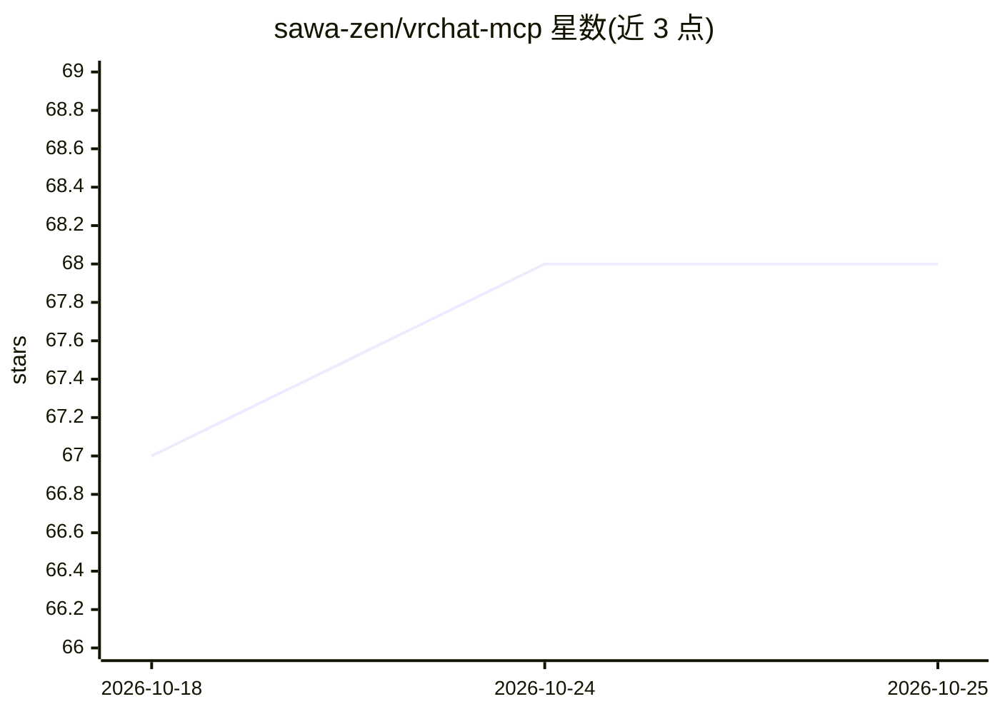

# sawa-zen/vrchat-mcp

⭐ 69 · TypeScript · MIT · 推送 2026-02-03 · [GitHub](https://github.com/sawa-zen/vrchat-mcp) · 个人维护

**让 AI 客户端通过 MCP 访问 VRChat API 的服务器**

基于 Model Context Protocol 的服务器，向 Claude Desktop 等 MCP 客户端暴露 VRChat API 能力：涵盖好友列表与好友请求、虚拟形象搜索与切换、世界搜索与收藏、实例创建与查询、群组、收藏、邀请消息与通知等工具。运行需设置 VRCHAT_USERNAME 与 VRCHAT_AUTH_TOKEN 环境变量，可通过 npx vrchat-mcp 直接启动，或在 Claude Desktop 配置文件中登记后自动加载。还提供 MCP Inspector 调试流程。

## 筛选速览

| 维度 | 判定 | 备注 |
|---|---|---|
| AI 角色 | `ai-ecosystem` | LLM/agent 周边工具 |
| 许可风险 | `permissive` | MIT |
| 部署形态 | `library` | 以包/库形式分发 |
| 模型依赖 | locked-api |  |
| 硬件要求 | — | 无带数字的原话,不猜 |
| 安装摩擦 | `low` | 无编译、无系统依赖或容器化 |
| 成熟度 | — | 结构信号不足 |

## 能力要点

- 覆盖用户/虚拟形象/世界/实例/群组/收藏/邀请/通知 8 类 VRChat 工具
- 支持 Claude Desktop 配置文件集成，无需手动启动
- npx vrchat-mcp 一行命令运行，附 auth token 获取命令
- 提供 MCP Inspector 调试指引

## 适用场景

- 让 Claude 等 AI 客户端查询我的 VRChat 好友与世界信息
- 通过对话在 VRChat 中切换虚拟形象或创建实例
- 调试和验证自定义 MCP 服务器与 VRChat API 的交互

## 场景标签

 · 领域:游戏/社交平台工具接入

## 证据(README 行号)

> L7: This project is a Model Context Protocol (MCP) server for interacting with the VRChat API. It allows you to retrieve
> L58: ## Usage with Claude Desktop

## 星数曲线

2026-10-18 67 → 2026-10-25 68（+1）

---
*卡片 v1 · prompt 1.4 · 生成 2026-10-24 · 置信度 high · 依据 README sha `a30a9d29a282` · [字段定义](../../DATASET.md)*
