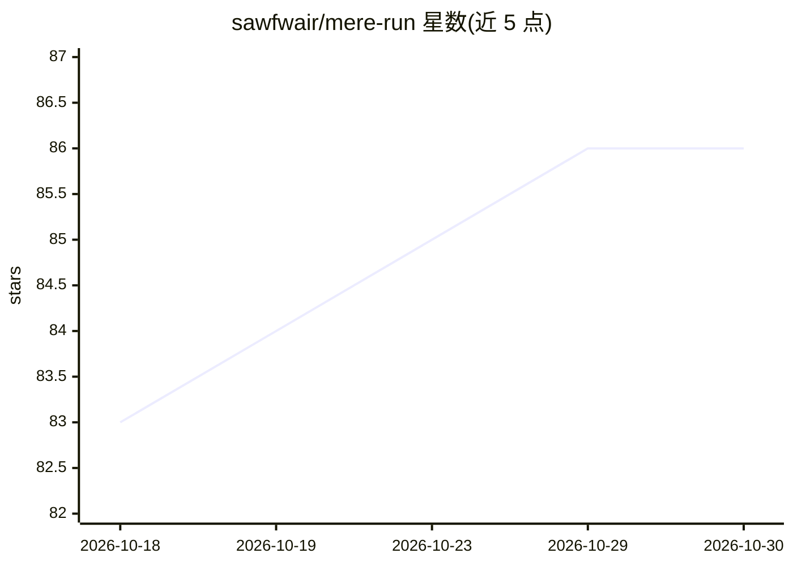

# sawfwair/mere-run

⭐ 86 · Swift · MIT · 推送 2026-10-29 · [GitHub](https://github.com/sawfwair/mere-run) · [官网](https://mere.run) · 个人维护

**本地 AI 运行时 CLI：跑模型、生成媒体、提供 OpenAI 兼容 API**

面向开发者与创作者的本地 AI 运行时，以 CLI（mere.run）与核心库形式发布。能力覆盖文本聊天/代码/嵌入、图像与视频生成、音乐/语音合成与转录、视觉分析、3D 重建、地理空间推理，支持 LoRA 适配器训练与模型评测。内置模型管理（model pull/info）与 api serve 命令，可启动仅监听回环地址的 OpenAI 兼容 API 服务（聊天/嵌入/图像/语音及原生视觉路由）。Apple Silicon macOS 为主平台，另有无头 Linux CUDA 包；macOS Studio 桌面应用与 iOS 客户端复用同一 CLI 与模型库。工作流以可移植图（graph/executor/relay）组织，支持本地、SSH 与 relay 执行。

## 筛选速览

| 维度 | 判定 | 备注 |
|---|---|---|
| AI 角色 | `ai-ecosystem` | LLM/agent 周边工具 |
| 许可风险 | `permissive` | MIT |
| 部署形态 | `desktop` | 安装包/桌面程序 |
| 模型依赖 | — | README 未给出锁定关系 |
| 硬件要求 | — | 无带数字的原话,不猜 |
| 安装摩擦 | `medium` | 含编译或系统依赖之一 |
| 成熟度 | — | 结构信号不足 |

## 能力要点

- 单一 CLI 覆盖文本、图像、视频、音乐、语音、视觉、3D、地理空间等多类本地推理工作流
- api serve 提供 OpenAI 兼容的聊天/嵌入/图像/语音端点与原生视觉路由
- 支持本地 LoRA 适配器训练、评测包校验与模型基准（eval/benchmark/gate）
- 可移植工作流图与不可变作业束，支持本地/SSH/relay 执行、断点续跑与产物校验

## 适用场景

- 在本机下载模型并生成图像、视频、音乐或语音，不依赖托管推理服务
- 为已有应用提供一个本地 OpenAI 兼容 API 服务端点
- 训练并评测 LoRA 适配器，管理本地模型库

## 场景标签

`推理引擎` `图像生成` `视频生成` `语音合成` · 领域:内容生成

## 证据(README 行号)

> L12: mere.run is a local AI runtime for developers and creators. Use its command-line
> L107: |API serving|`api serve`, `open-webui quickstart`, `model runtime`, `status`|OpenAI-compatible chat, embeddings, i

## 星数曲线

2026-10-18 83 → 2026-10-30 86（+3）

---
*卡片 v1 · prompt 1.4 · 生成 2026-10-24 · 置信度 mid · 依据 README sha `0be6d4a2718b` · [字段定义](../../DATASET.md)*
