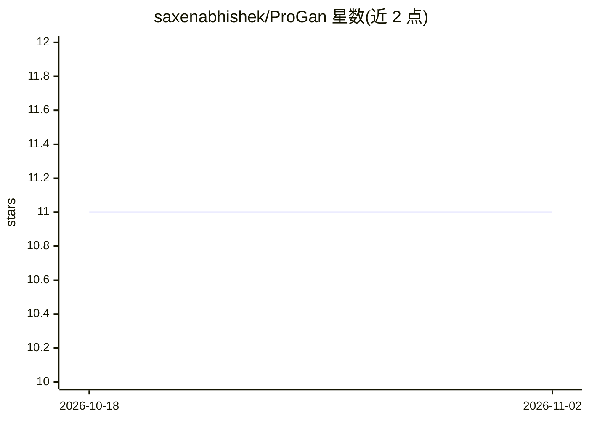

# saxenabhishek/ProGan

⭐ 11 · Python · MIT · 推送 2026-07-17 · [GitHub](https://github.com/saxenabhishek/ProGan) · 个人维护

**给开发者的 ProGAN 论文 PyTorch 复现：渐进式生长的图像生成训练包**

以 Python 包形式复现论文《Progressive Growing of GANs》，提供渐进生长模型、层线性淡入、像素归一化、小批量标准差、均衡学习率等实现，默认 WGANGP 损失、可选 LSGAN。trainer 类暴露超参数与 step_up/step_dn 控制模型逐层生长，支持每 epoch 保存权重与断点续训；eva 模块从保存的权重生成图像与潜空间漫步。训练需要 GPU，Python 3.8+，通过 git clone 并 pip 安装依赖后运行。

## 筛选速览

| 维度 | 判定 | 备注 |
|---|---|---|
| AI 角色 | `ai-native` | 本体是模型或模型工具 |
| 许可风险 | `permissive` | MIT |
| 部署形态 | `library` | 以包/库形式分发 |
| 模型依赖 | — | README 未给出锁定关系 |
| 硬件要求 | — | 无带数字的原话,不猜 |
| 安装摩擦 | `low` | 无编译、无系统依赖或容器化 |
| 成熟度 | — | 结构信号不足 |

## 能力要点

- 渐进生长 GAN 完整实现（step_up/step_dn 控制逐层生长）
- WGANGP 默认损失，可选 LSGAN
- 每 epoch 自动保存权重，支持断点续训
- eva 模块从保存权重生成图像与潜空间漫步

## 适用场景

- 在自定义图像数据集上训练渐进生长 GAN
- 学习 ProGAN 论文机制的代码实现
- 从已训练权重生成样本图像与潜空间插值

## 场景标签

`图像生成` · 领域:内容生成

## 证据(README 行号)

> L14: This project is a reimplementation of the paper Progressive Growing of GANs for Improved Quality, Stability, and Va
> L16: This repository is developed like a python package, so it is easy to start training on any dataset quickly. Everyth

## 星数曲线

2026-10-18 11 → 2026-11-02 11（+0）

---
*卡片 v1 · prompt 1.4 · 生成 2026-11-01 · 置信度 mid · 依据 README sha `5d52fc9865f3` · [字段定义](../../DATASET.md)*
