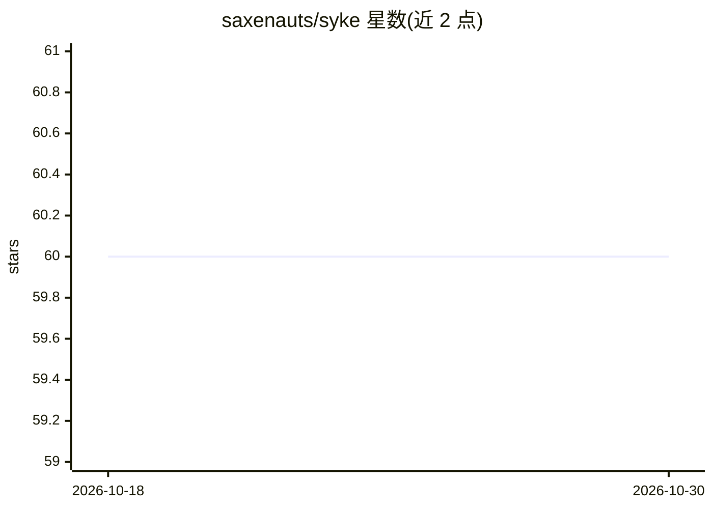

# saxenauts/syke

⭐ 60 · Python · AGPL-3.0 · 推送 2026-10-29 · [GitHub](https://github.com/saxenauts/syke) · [官网](https://dev.mysyke.com) · 组织维护

**给 AI agent 用户的本地记忆代理：跨工具汇合记忆供 agent 调用**

以后台常驻方式运行的本地记忆 agent：读取 Claude Code、Codex、Cursor、Copilot 等 8 种本地 agent 工具的活动痕迹，维护对象/意图/进度的连贯时间线，输出为 MEMEX.md 投影与 `syke ask/record/memex` CLI，供其他 agent 在工作流中调用；使用 Pi agent core 做认证与运行时，数据全部存于 ~/.syke/。README 声明项目处于实验阶段且不完整，pre-1.0 可能有意做兼容性破坏。

## 筛选速览

| 维度 | 判定 | 备注 |
|---|---|---|
| AI 角色 | `ai-ecosystem` | LLM/agent 周边工具 |
| 许可风险 | `viral` | AGPL-3.0 |
| 部署形态 | `library` | 以包/库形式分发 |
| 模型依赖 | — | README 未给出锁定关系 |
| 硬件要求 | — | 无带数字的原话,不猜 |
| 安装摩擦 | `low` | 无编译、无系统依赖或容器化 |
| 成熟度 | `idea` | |

## 能力要点

- 读取 8 种本地 agent 工具的历史痕迹并做记忆合成
- 提供 syke ask / record / memex 命令与 MEMEX.md 记忆投影
- syke web 本地可视化时间线（记忆循环、ask 轨迹、diff）
- macOS 上模型工具运行于文件系统沙箱，会话/记录等目录只读

## 适用场景

- 我在多个编码 agent 工具间切换，想要一个共享的持续记忆
- 让终端 agent 通过 syke ask 获取项目当前上下文
- 用 syke record 记录决策并纳入下次记忆合成

## 场景标签

`Agent 记忆` · 领域:Agent 开发

## 证据(README 行号)

> L8: Syke is a local memory agent that works with your other AI agents.
> L12: It runs in the background as an ambient agent, keeps up with your work
> L16: It reads your local agent activity and maintains a coherent timeline of objects,

## 星数曲线

2026-10-18 60 → 2026-10-30 60（+0）

---
*卡片 v1 · prompt 1.4 · 生成 2026-10-24 · 置信度 high · 依据 README sha `07a295b50a77` · [字段定义](../../DATASET.md)*
