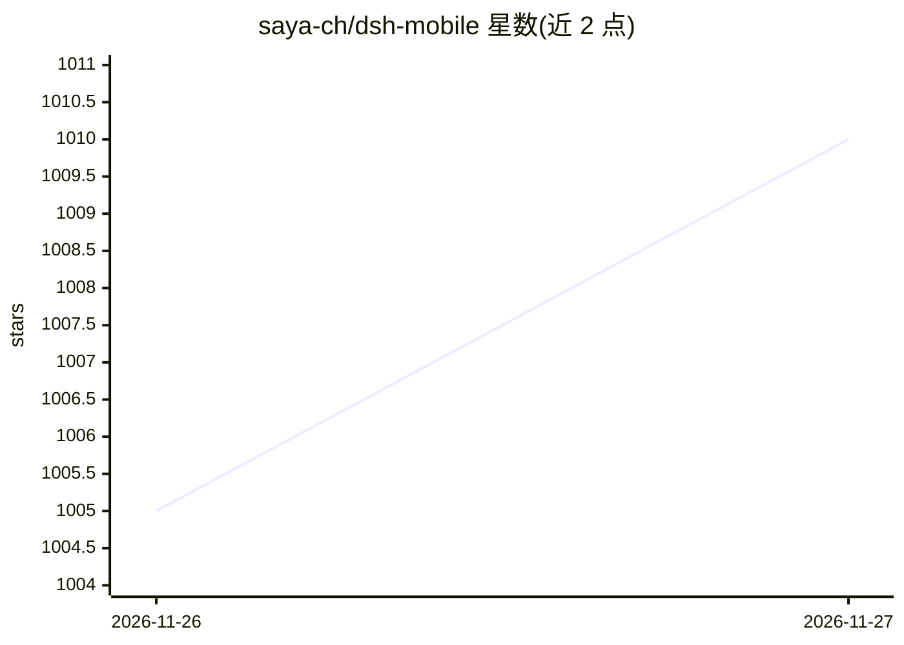

# saya-ch/dsh-mobile

⭐ 1,010 · TypeScript · Apache-2.0 · 推送 2026-11-26 · [GitHub](https://github.com/saya-ch/dsh-mobile) · 个人维护 · 中文 README

**给手机远程访问电脑端 DeepSeek Harness 的插件与 Android App**

以 DeepSeek Harness 社区插件形式提供的移动访问方案：手机浏览器或 Android App 经局域网或多种远程通道（Tailscale Funnel、cpolar、cloudflared、自建 FRP、反向代理、实验性 iroh）连接电脑，继续使用同一份会话、工作区、消息和工具。采用独立 HTTPS 与设备配对授权，支持扫码/链接配对、设备撤销、一键诊断、iPhone/iPad 主屏幕 PWA 与网页推送。插件不修改 DSH 源码；远程通知不保证送达，配对设备应视为完全受信任。

## 筛选速览

| 维度 | 判定 | 备注 |
|---|---|---|
| AI 角色 | `ai-ecosystem` | LLM/agent 周边工具 |
| 许可风险 | `permissive` | Apache-2.0 |
| 部署形态 | `desktop` | 安装包/桌面程序 |
| 模型依赖 | locked-api |  |
| 硬件要求 | — | 无带数字的原话,不猜 |
| 安装摩擦 | `low` | 无编译、无系统依赖或容器化 |
| 成熟度 | `idea` | |

## 能力要点

- 六种远程通道与局域网双套独立开关及配对授权管理
- 扫码/链接/密钥一次配对，App 集中显示并检测已配对电脑
- iPhone/iPad 主屏幕 Web App（PWA）与六类网页推送
- 对话内 /mobile 定制手机端与移动访问 skill 组件

## 适用场景

- 在手机上继续操作电脑端 DeepSeek Harness 的会话与工具
- 离开电脑网络时经隧道远程访问自己的 DSH
- 用对话让 agent 完成通道配置与排障

## 场景标签

`AI 助手` · 领域:对话与助手

## 证据(README 行号)

> L51: DSH Mobile 是一个 DeepSeek Harness 插件，让手机浏览器或 Android App 通过局域网，或可选的 Tailscale Funnel、cpolar、cloudflared、自建 FRP、自有反向代理
> L55: 它还能在 DSH 对话里用 `/mobile <需求>` 定制手机端。

## 星数曲线

2026-11-26 1,005 → 2026-11-27 1,010（+5）

---
*卡片 v1 · prompt 1.4 · 生成 2026-11-27 · 置信度 high · 依据 README sha `10c1c072d176` · [字段定义](../../DATASET.md)*
