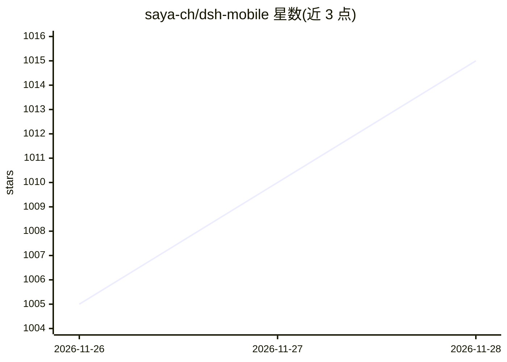

# saya-ch/dsh-mobile

⭐ 1,015 · TypeScript · Apache-2.0 · 推送 2026-11-27 · [GitHub](https://github.com/saya-ch/dsh-mobile) · 个人维护 · 中文 README

**在手机上安全远程访问电脑端 DeepSeek Harness 的插件与 Android App**

DSH Mobile 是 DeepSeek Harness 的社区插件，让手机浏览器或 Android App 通过局域网或多种远程通道连接电脑，继续使用电脑上的会话、工作区、消息和工具。支持 Tailscale Funnel、cpolar、cloudflared、自建 FRP、自有反向代理与实验性 iroh 六类通道；提供扫码/链接配对与多设备管理、独立 HTTPS 与设备令牌、第三方 WS 默认拦截等安全机制，并支持对话定制手机端与 iOS 网页推送。插件不修改 DSH 源码；Windows 客户端为 alpha 预览，正式版仅覆盖 Android。

## 筛选速览

| 维度 | 判定 | 备注 |
|---|---|---|
| AI 角色 | `ai-ecosystem` | LLM/agent 周边工具 |
| 许可风险 | `permissive` | Apache-2.0 |
| 部署形态 | `desktop` | 安装包/桌面程序 |
| 模型依赖 | locked-api |  |
| 硬件要求 | — | 无带数字的原话,不猜 |
| 安装摩擦 | `low` | 无编译、无系统依赖或容器化 |
| 成熟度 | `idea` | |

## 能力要点

- 局域网与六种远程通道（含实验性 iroh 加密直连）可分别启停与分别配对
- 独立 HTTPS 与设备配对，凭据存 Keystore，第三方 WS 默认拦截
- 移动访问 skill 使通道配置与排障可在 DSH 对话中完成
- iPhone/iPad 主屏幕 PWA 与网页推送，无需原生 iOS App

## 适用场景

- 在同一 Wi-Fi 下用手机继续电脑端的 DSH 会话与工具
- 外出时通过隧道或 iroh 远程操作电脑上的编码 agent
- 为家中 iPad 添加主屏幕 Web App 并接收任务通知
- 为多台已配对电脑统一管理设备授权与可达状态

## 场景标签

 · 领域:开发者工具/远程访问

## 证据(README 行号)

> L29: > DSH Mobile 是 DeepSeek Harness 社区插件，原生 App 目前正式支持 Android；另有 **Windows 客户端（alpha 预览）**，支持 Windows 10 / 11 x64：下载安装
> L51: DSH Mobile 是一个 DeepSeek Harness 插件，让手机浏览器或 Android App 通过局域网，或可选的 Tailscale Funnel、cpolar、cloudflared、自建 FRP、自有反向代理
> L63: - **多种远程通道**：Tailscale、cpolar、cloudflared 快速/命名隧道、自建 FRP、自有反向代理，以及无需域名和公网端口的实验性 iroh；Windows/Linux x64 还可由插件托管 Cadd

## 星数曲线

2026-11-26 1,005 → 2026-11-28 1,015（+10）

---
*卡片 v1 · prompt 1.4 · 生成 2026-11-28 · 置信度 high · 依据 README sha `649d8a48e81e` · [字段定义](../../DATASET.md)*
