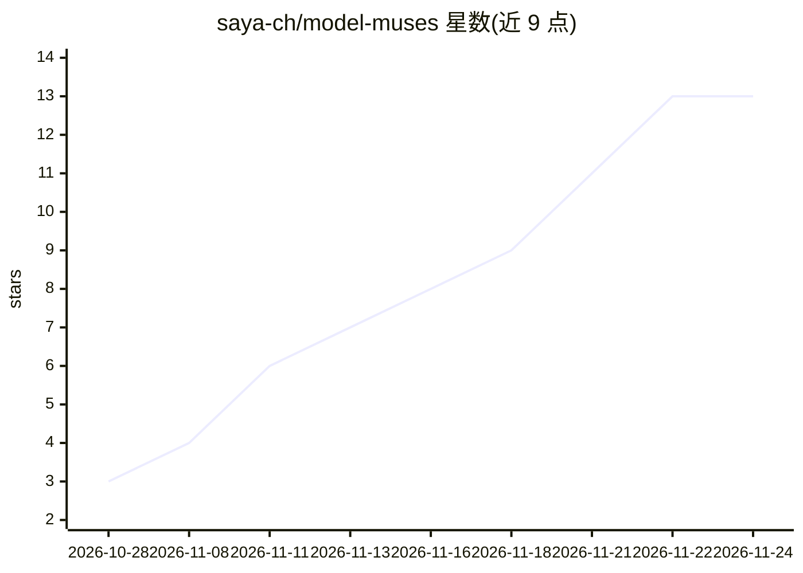

# saya-ch/model-muses

⭐ 13 · Python · NOASSERTION · 推送 2026-11-22 · [GitHub](https://github.com/saya-ch/model-muses) · 个人维护 · 中文 README

**32 个 AI 模型与平台的拟人立绘索引与版权溯源**

收录 32 个大模型、AI 工具与算力基础设施的拟人形象立绘原画，全部为同一画师、同一画风的白底全身立绘，规格统一可横向对比。每个对象配一段技术本体说明（架构机制、能力方向、协议授权，刻意不写版本号与跑分），并附官方链接索引。另含 102 张变体画廊与 1075 件作品的缩略图索引，逐图标注来源、作者与授权档位。仓库声明非官方项目，图片需回原作品页联系原作者取得二次使用授权。

## 筛选速览

| 维度 | 判定 | 备注 |
|---|---|---|
| AI 角色 | `ai-knowledge` | 知识聚合/清单类 |
| 许可风险 | `none` | NOASSERTION |
| 部署形态 | `None` |  |
| 模型依赖 | — | README 未给出锁定关系 |
| 硬件要求 | — | 无带数字的原话,不猜 |
| 安装摩擦 | `low` | 无编译、无系统依赖或容器化 |
| 成熟度 | — | 结构信号不足 |

## 能力要点

- 32 张同画师同风格的白底全身立绘，支持横向对比
- 每张图逐条完成来源溯源与授权档位标注
- 每个对象配稳定事实型技术说明与官方链接
- 画廊含 102 张变体与 1075 件作品的缩略图索引

## 适用场景

- 查找某 AI 模型或平台的拟人形象素材及授权状态
- 按统一规格横向对比各模型厂商的视觉设计
- 查询各 AI 模型的官网、文档与代码仓库入口

## 场景标签

`精选清单` · 领域:学习与行业

## 证据(README 行号)

> L5: 本仓库收录 32 个主流大模型、AI 工具、算力与边缘基础设施的拟人形象立绘原画。全部图片出自**同一位画师、同一画风**的白底全身立绘，规格统一，可横向对比。其中 22 个对象取自蓝色大肥鱼站的立绘作品页并逐张完成溯源匹配；**文
> L19: 每张图配一段**对象本体的技术说明**——它属于哪一类技术、采用什么架构机制、在什么方向上有独特性。**只写稳定事实，不写版本号、跑分、价格与市场份额**；下表为压缩版，更完整的对照见 docs/角色设定与设计规律.md。
> L191: |`原画/mimo-ref.jpg`|**CC BY-NC** —— 著作权归 @甶丶 所有。允许非商业使用与二次创作，**须署名**|

## 星数曲线

2026-10-28 3 → 2026-11-24 13（+10）

---
*卡片 v1 · prompt 1.4 · 生成 2026-11-20 · 置信度 high · 依据 README sha `4898090edd2e` · [字段定义](../../DATASET.md)*
