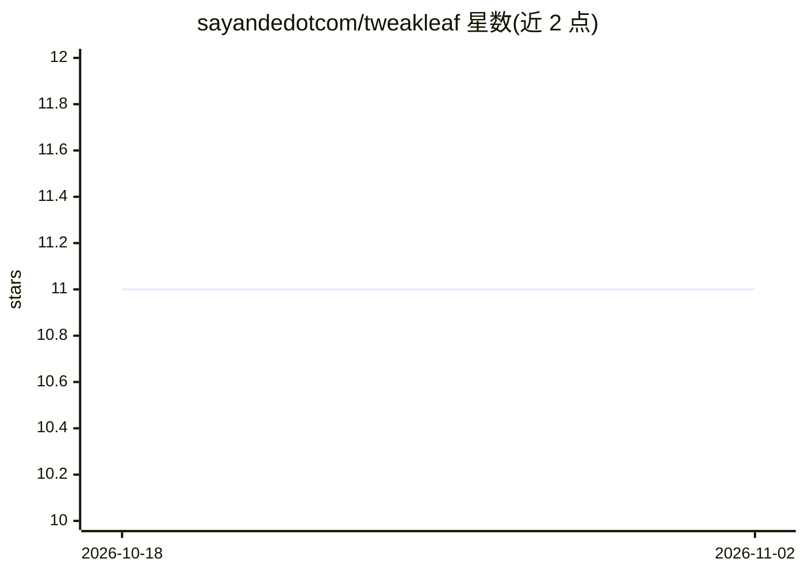

# sayandedotcom/tweakleaf

⭐ 11 · TypeScript · MIT · 推送 2025-12-08 · [GitHub](https://github.com/sayandedotcom/tweakleaf) · [官网](https://tweakleaf.com) · 组织维护

**用 AI Agent 生成和优化 LaTeX 简历与求职信的 Web 平台**

面向求职者的 AI 文档生成平台：根据职位描述自动生成或修改 LaTeX 格式简历与求职信，宣称支持 ATS 优化、约 10 秒生成文档、跨会话长期记忆用户偏好，内置 LaTeX 编辑器与编译器。支持接入 OpenAI、Anthropic、Gemini、DeepSeek、Hugging Face 多家模型，用户自备 API key，使用 Gemini key 时免费。自托管需克隆源码、pnpm 安装依赖并配置环境变量，技术栈为 Next.js 15 / React 19 / Supabase / SST 部署。

## 筛选速览

| 维度 | 判定 | 备注 |
|---|---|---|
| AI 角色 | `ai-native` | 本体是模型或模型工具 |
| 许可风险 | `permissive` | MIT |
| 部署形态 | `library` | 以包/库形式分发 |
| 模型依赖 | — | README 未给出锁定关系 |
| 硬件要求 | — | 无带数字的原话,不猜 |
| 安装摩擦 | `low` | 无编译、无系统依赖或容器化 |
| 成熟度 | — | 结构信号不足 |

## 能力要点

- 根据职位描述生成 LaTeX 简历与求职信，约 10 秒
- 支持 OpenAI / Anthropic / Gemini / DeepSeek / Hugging Face 多模型
- 内置 LaTeX 编辑器与编译器（CodeMirror）
- 长期记忆功能，跨会话保留用户偏好

## 适用场景

- 求职者快速针对不同职位定制简历和求职信
- 生成 LaTeX 排版的专业文档
- 批量投递时降低模型调用成本（自备 Gemini key 免费）

## 场景标签

`AI 写作` · 领域:内容生成

## 证据(README 行号)

> L5:  Tweak your LaTeX resumes and cover letters with AI Agents!
> L16: Tweakleaf is an AI-powered platform that revolutionizes job applications by automatically generating and optimizing

## 星数曲线

2026-10-18 11 → 2026-11-02 11（+0）

---
*卡片 v1 · prompt 1.4 · 生成 2026-11-01 · 置信度 high · 依据 README sha `043c81cc338c` · [字段定义](../../DATASET.md)*
