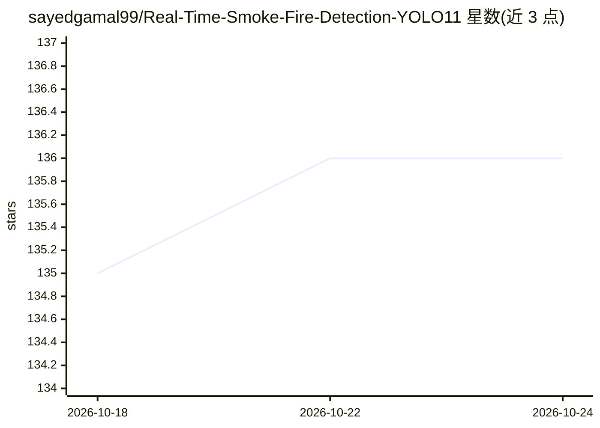

# sayedgamal99/Real-Time-Smoke-Fire-Detection-YOLO11

⭐ 136 · Python · 推送 2026-04-25 · [GitHub](https://github.com/sayedgamal99/Real-Time-Smoke-Fire-Detection-YOLO11) · [官网](https://sayedgamal99.github.io/Real-Time-Smoke-Fire-Detection-YOLO11/) · 个人维护

**用 YOLO11 实时检测火焰与烟雾并经 Telegram 告警的系统**

基于 YOLOv11 目标检测模型的火焰与烟雾检测系统：对视频流或摄像头画面做实时推理（README 标称 30-60 FPS），检测到火情或烟雾时通过 Telegram/WhatsApp 发送带图片的告警，并采用多线程保持检测不中断。模型在 Roboflow 上 10,463 张标注图像（Fire/Smoke 两类）上训练，验证集 Precision 0.806、mAP@50 0.770。使用方式为克隆仓库后安装 ultralytics，通过 yolo CLI 命令对图片或摄像头执行推理。

## 筛选速览

| 维度 | 判定 | 备注 |
|---|---|---|
| AI 角色 | `ai-native` | 本体是模型或模型工具 |
| 许可风险 | `none` | — |
| 部署形态 | `library` | 以包/库形式分发 |
| 模型依赖 | — | README 未给出锁定关系 |
| 硬件要求 | — | 无带数字的原话,不猜 |
| 安装摩擦 | `low` | 无编译、无系统依赖或容器化 |
| 成熟度 | — | 结构信号不足 |

## 能力要点

- YOLOv11 实时检测 Fire 与 Smoke 两类目标
- 检测到威胁时经 Telegram/WhatsApp 发送带图告警
- 多线程设计，告警发送不中断检测
- 提供训练数据集（10,463 张标注图像）与训练/验证指标

## 适用场景

- 对监控摄像头画面做火焰烟雾的实时检测
- 工厂、仓库等场所接入视频流并在起火时接收即时告警
- 复用数据集与权重训练或评估自己的消防检测模型

## 场景标签

`目标检测` · 领域:感知与多模态

## 证据(README 行号)

> L40: **Flare Guard** represents a state-of-the-art approach to fire safety monitoring. At its core, the system uses **YO
> L140: yolo detect predict model=models/best_nano_111.pt source=data/house.png conf=0.35 iou=0.1

## 星数曲线

2026-10-18 135 → 2026-10-24 136（+1）

---
*卡片 v1 · prompt 1.4 · 生成 2026-10-22 · 置信度 mid · 依据 README sha `617cb02ef83a` · [字段定义](../../DATASET.md)*
