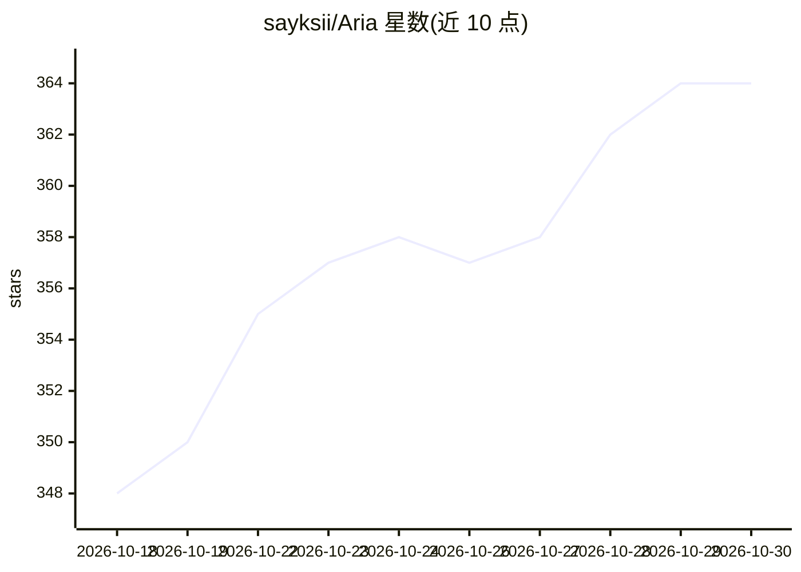

# sayksii/Aria

⭐ 364 · Python · GPL-3.0 · 推送 2026-08-09 · [GitHub](https://github.com/sayksii/Aria) · 个人维护 · 中文 README

**Windows 实时字幕桌面应用：系统音频转可移动悬浮字幕**

Windows 桌面应用，捕获系统音频或麦克风，经语音识别后以可移动悬浮窗显示实时字幕，并可另开悬浮窗显示翻译。提供 Lite（依赖 Windows Live Captions）与 Full（内置离线模型）两种下载包，Full 包含三种识别模式：Faster-Whisper 精确模式（NVIDIA GPU 更佳）、Sherpa-ONNX/Vosk 实时模式、Windows Live Captions 模式。翻译可选 Google/Bing/有道或本地 NLLB 模型。包内自带 Python 运行时，解压后运行 bat 启动，无需单独安装 Python。

## 筛选速览

| 维度 | 判定 | 备注 |
|---|---|---|
| AI 角色 | `ai-native` | 本体是模型或模型工具 |
| 许可风险 | `viral` | GPL-3.0 |
| 部署形态 | `None` |  |
| 模型依赖 | — | README 未给出锁定关系 |
| 硬件要求 | — | 无带数字的原话,不猜 |
| 安装摩擦 | `medium` | 含编译或系统依赖之一 |
| 成熟度 | — | 结构信号不足 |

## 能力要点

- 三种识别模式：Faster-Whisper / Sherpa-ONNX·Vosk / Windows Live Captions
- 识别文本可发送至 Google、Bing、有道或本地 NLLB 模型翻译
- Full 包内置离线模型（Whisper Large-v3、Sherpa-ONNX、Vosk、NLLB）
- 包内自带 Python 运行时，无需单独安装

## 适用场景

- 看外语视频或参加线上会议时显示实时字幕
- 游戏或通话中的实时语音转文字
- 离线环境下用本地模型做字幕与翻译

## 场景标签

`语音识别` · 领域:感知与多模态

## 证据(README 行号)

> L8: ARIA is a Windows desktop app for turning system audio into live subtitles. It can listen to audio from video player
> L31: |Mode|Engine|Good fit|Notes|

## 星数曲线

2026-10-18 348 → 2026-10-30 364（+16）

---
*卡片 v1 · prompt 1.4 · 生成 2026-10-21 · 置信度 high · 依据 README sha `f4b0ff181092` · [字段定义](../../DATASET.md)*
