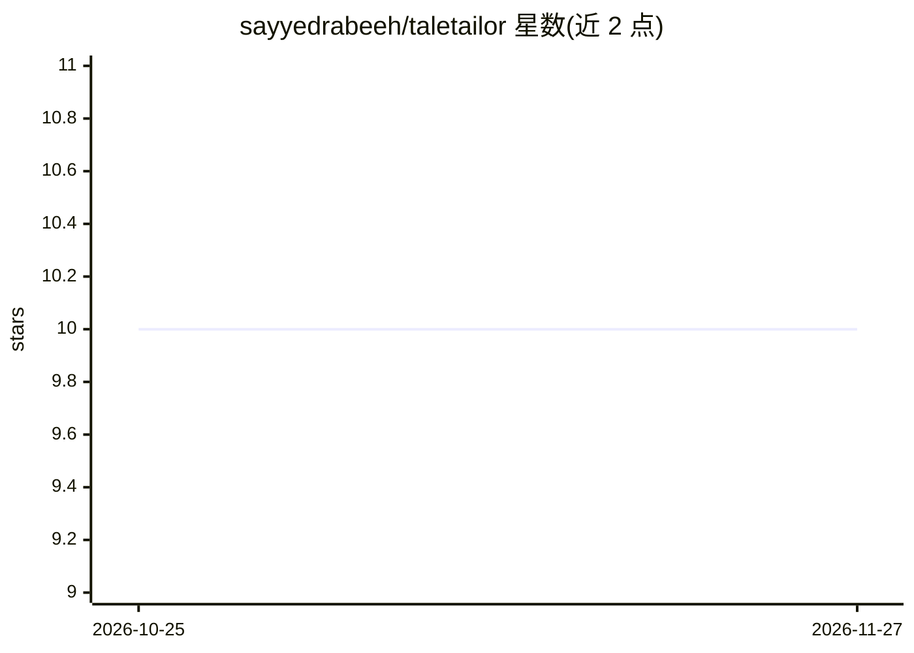

# sayyedrabeeh/taletailor

⭐ 10 · Python · MIT · 推送 2026-01-06 · [GitHub](https://github.com/sayyedrabeeh/taletailor) · [官网](https://taletailor.onrender.com/) · 个人维护

**面向创作者的 AI 故事生成加故事社交平台**

基于 Django 的全栈平台，调用 HuggingFace Falcon-7b-instruct 接口按情绪、题材、篇幅、人物关系等参数生成故事；支持多人协作编辑、权限控制与发布流程，并提供类似社交媒体的故事信息流、搜索、点赞、浏览统计与用户主页。附一键翻译、文本转语音、PDF 导出与按情绪切换界面主题的功能，含管理员后台。安装需 Python 3.8+、Django 4.0+ 与 PostgreSQL。

## 筛选速览

| 维度 | 判定 | 备注 |
|---|---|---|
| AI 角色 | `ai-native` | 本体是模型或模型工具 |
| 许可风险 | `permissive` | MIT |
| 部署形态 | `library` | 以包/库形式分发 |
| 模型依赖 | — | README 未给出锁定关系 |
| 硬件要求 | — | 无带数字的原话,不猜 |
| 安装摩擦 | `low` | 无编译、无系统依赖或容器化 |
| 成熟度 | — | 结构信号不足 |

## 能力要点

- 调用 HuggingFace Falcon-7b-instruct API 生成可定制题材与情绪的故事
- 协作编辑与协作邀请、权限与贡献跟踪
- 故事 UI 随情绪主题动态变化
- 一键翻译、gTTS 文本转语音与 PDF 导出

## 适用场景

- 按题材和情绪快速生成故事草稿
- 多人协作共同创作一篇故事并发布
- 在一个社区里浏览、搜索和点赞他人作品

## 场景标签

`AI 写作` `语音合成` · 领域:内容生成

## 证据(README 行号)

> L23: Tale Tailor is a revolutionary full-stack platform that brings together cutting-edge AI story generation with vibra
> L138: - **AI Integration**: HuggingFace Falcon-7b-instruct model
> L224: def generate_story(prompt):

## 星数曲线

2026-10-25 10 → 2026-11-27 10（+0）

---
*卡片 v1 · prompt 1.4 · 生成 2026-11-19 · 置信度 high · 依据 README sha `9c2e33b441a0` · [字段定义](../../DATASET.md)*
