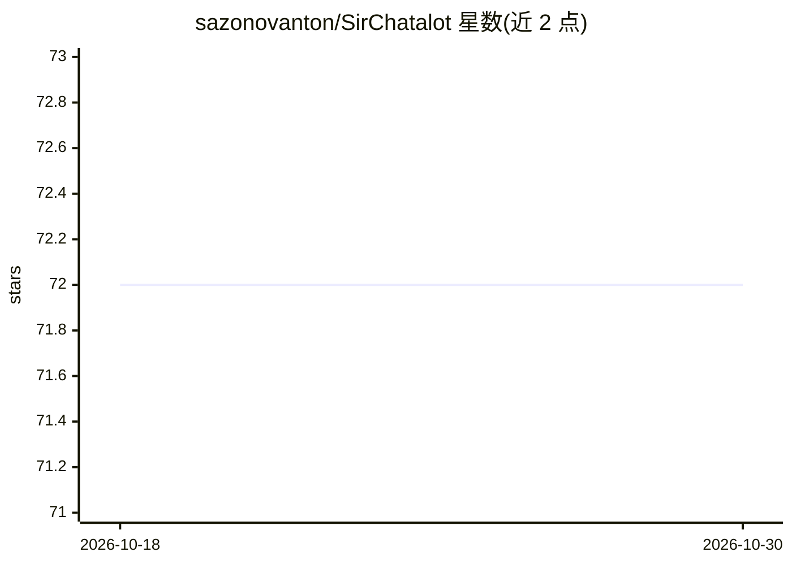

# sazonovanton/SirChatalot

⭐ 72 · Python · GPL-3.0 · 推送 2026-08-07 · [GitHub](https://github.com/sazonovanton/SirChatalot) · 个人维护

**面向 Telegram 用户的 AI 对话机器人：多模型接入与代理工具**

Python 实现的 Telegram 聊天机器人，连接任意 OpenAI 兼容 API（OpenAI、OpenRouter、Ollama、vLLM 等本地模型及 Anthropic/YandexGPT 兼容端点），支持多模型配置、用户在聊天中切换模型与自动回退链。能力覆盖代理式工具调用（生图、搜索、读网页）、MCP 服务器接入、对上传文档的 RAG（分块嵌入 ChromaDB）、用户记忆、视觉、Whisper 语音转录与图像生成。单一 YAML 文件配置，可选功能按配置节存在与否启停；语音功能需 ffmpeg。安装方式为 clone 源码加 pip 依赖，或 Docker Compose。

## 筛选速览

| 维度 | 判定 | 备注 |
|---|---|---|
| AI 角色 | `ai-native` | 本体是模型或模型工具 |
| 许可风险 | `viral` | GPL-3.0 |
| 部署形态 | `self-host` | docker 或自建部署 |
| 模型依赖 | local-ok | 支持本地模型 |
| 硬件要求 | — | 无带数字的原话,不猜 |
| 安装摩擦 | `low` | 无编译、无系统依赖或容器化 |
| 成熟度 | — | 结构信号不足 |

## 能力要点

- 任意 OpenAI 兼容 API 接入，支持多模型配置、/model 切换与自动回退链
- MCP 服务器接入（stdio / streamable-http），工具以 mcp__<server>__<tool> 形式暴露
- 上传文档分块嵌入 ChromaDB 的代理式 RAG，支持本地 ONNX MiniLM 嵌入（无需 API 调用）
- 用户记忆、滚动摘要压缩历史、Whisper 语音转录与图像生成

## 适用场景

- 在 Telegram 里搭建自己的多模型 AI 助手并随时切换模型
- 让 bot 基于我上传的 PDF/DOCX 文档回答问题
- 通过 MCP 服务器扩展 bot 的工具能力
- 在本地 Ollama/vLLM 模型上跑一个带工具与记忆的聊天机器人

## 场景标签

`聊天机器人` `AI 助手` `RAG` `图像生成` · 领域:对话与助手

## 证据(README 行号)

> L3: A Telegram bot that proves you don't need a body to have a personality.
> L5: The bot talks to any **OpenAI-compatible** chat API — OpenAI, OpenRouter, local models
> L13: * **Agentic tool use** — the model can generate images, search the web, open URLs,

## 星数曲线

2026-10-18 72 → 2026-10-30 72（+0）

---
*卡片 v1 · prompt 1.4 · 生成 2026-10-24 · 置信度 mid · 依据 README sha `29a473447df4` · [字段定义](../../DATASET.md)*
