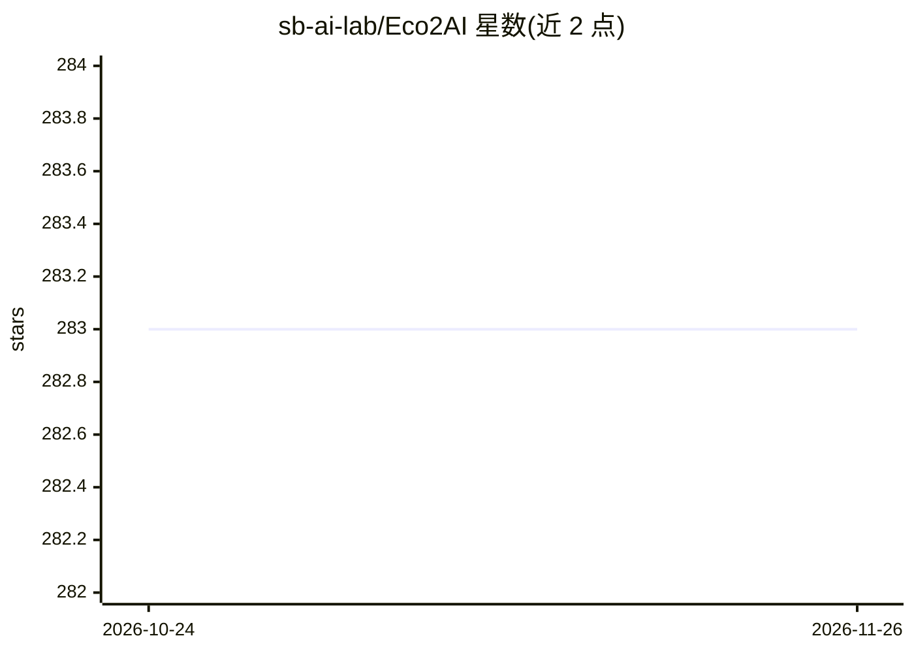

# sb-ai-lab/Eco2AI

⭐ 283 · Python · Apache-2.0 · 推送 2026-11-03 · [GitHub](https://github.com/sb-ai-lab/Eco2AI) · 组织维护

**跟踪 Python 代码运行的能耗与 CO2 排放的库**

Python 库，监控代码运行期间 CPU/GPU 设备的能耗，结合区域排放系数估算等效碳排放，并将每次 Tracker 会话的功耗、排放、设备与时长信息记录到本地文件。通过在代码中添加 Tracker、@track 装饰器或 with 上下文管理器接入，支持 Lightning 回调；提供 CLI 设置结果目录。需要在使用 GPU/CPU 前创建 Tracker 才能正确计算功耗。

## 筛选速览

| 维度 | 判定 | 备注 |
|---|---|---|
| AI 角色 | `ai-ecosystem` | LLM/agent 周边工具 |
| 许可风险 | `permissive` | Apache-2.0 |
| 部署形态 | `library` | 以包/库形式分发 |
| 模型依赖 | — | README 未给出锁定关系 |
| 硬件要求 | — | 无带数字的原话,不猜 |
| 安装摩擦 | `low` | 无编译、无系统依赖或容器化 |
| 成熟度 | — | 结构信号不足 |

## 能力要点

- 监控 CPU/GPU 能耗并按区域排放系数估算 CO2 排放
- 支持 Tracker、装饰器、上下文管理器三种接入方式
- 每次运行写入会话记录（功耗、排放、设备、时长）到本地文件
- 提供 PyTorch Lightning 的 Eco2AICallback 集成

## 适用场景

- 记录深度学习模型训练的能耗与碳排放数据
- 对比不同实验配置的电力消耗
- 为 ESG 报告收集代码运行的排放统计

## 场景标签

 · 领域:AI 可持续性/能耗与碳排放追踪

## 证据(README 行号)

> L15: The Eco2AI is a python library for CO 2 emission tracking. It monitors energy consumption of CPU & GPU devices and 
> L18: Every single run of Tracker() accompanies by a session description added to the log file, including the following e

## 星数曲线

2026-10-24 283 → 2026-11-26 283（+0）

---
*卡片 v1 · prompt 1.4 · 生成 2026-11-25 · 置信度 high · 依据 README sha `661207da9a88` · [字段定义](../../DATASET.md)*
