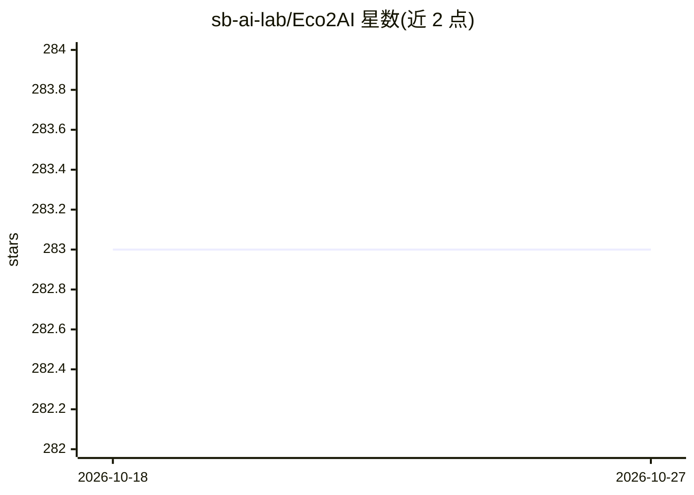

# sb-ai-lab/Eco2AI

⭐ 283 · Python · Apache-2.0 · 推送 2026-10-06 · [GitHub](https://github.com/sb-ai-lab/Eco2AI) · 组织维护

**追踪 Python 代码运行能耗与 CO2 排放的 Python 库**

eco2AI 是用于 CO2 排放追踪的 Python 库：监控 CPU 与 GPU 设备的能耗，结合区域排放系数估算等效碳排放，可应用于任意 Python 脚本，只需在代码中加入数行即可。每次 Tracker() 运行会向本地日志文件写入会话记录，含项目名、时长、功耗（kWh）、CO2 排放量（kg）、CPU/GPU 型号、操作系统与国家等字段；也支持装饰器方式记录到 emission.csv。无法识别国家时采用 436.529kg/MWh 的全球平均系数。论文中展示了追踪 ruDALL-E 系列模型微调排放的实验。

## 筛选速览

| 维度 | 判定 | 备注 |
|---|---|---|
| AI 角色 | `ai-ecosystem` | LLM/agent 周边工具 |
| 许可风险 | `permissive` | Apache-2.0 |
| 部署形态 | `library` | 以包/库形式分发 |
| 模型依赖 | — | README 未给出锁定关系 |
| 硬件要求 | — | 无带数字的原话,不猜 |
| 安装摩擦 | `low` | 无编译、无系统依赖或容器化 |
| 成熟度 | — | 结构信号不足 |

## 能力要点

- 监控 CPU/GPU 能耗并结合区域排放系数估算 CO2 排放
- Tracker 会话日志含功耗、排放、设备型号、国家等字段
- 支持装饰器 @track 自动记录到 emission.csv
- 配套论文（Doklady Mathematics, DOI 10.1134/S1064562422060230）

## 适用场景

- 统计深度学习模型训练或推理的碳排放与能耗
- 为论文/ESG 报告记录实验的碳足迹数据
- 在任意 Python 脚本中低侵入接入排放追踪

## 场景标签

`MLOps` · 领域:训练与推理

## 证据(README 行号)

> L15: The Eco2AI is a python library for CO 2 emission tracking. It monitors energy consumption of CPU & GPU devices and 
> L16: The Eco2AI is applicable to all python scripts and all you need is to add the couple of strings to your code. All e

## 星数曲线

2026-10-18 283 → 2026-10-27 283（+0）

---
*卡片 v1 · prompt 1.4 · 生成 2026-10-22 · 置信度 high · 依据 README sha `234a983cd995` · [字段定义](../../DATASET.md)*
