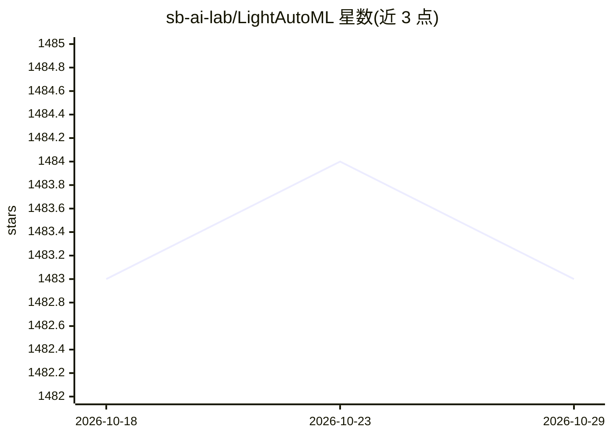

# sb-ai-lab/LightAutoML

⭐ 1,483 · Python · Apache-2.0 · 推送 2026-10-22 · [GitHub](https://github.com/sb-ai-lab/LightAutoML) · 组织维护

**面向数据科学家的 AutoML 框架：少量代码自动生成 ML 模型**

LightAutoML (LAMA) 是用 Python 编写的 AutoML 框架，支持表格、时间序列、图像与文本数据建模。提供两条使用路径：开箱即用的 preset（如 TabularAutoML 几行代码完成训练与预测），或以现成模块（特征生成/选择、ML 算法、超参优化）组装自定义流水线。附带 Kaggle 实战示例与 Colab 教程，覆盖白盒可解释模型、NLP、uplift 建模、CV 多分类、神经网络等场景；GPU 与 Spark 流水线尚在开发测试中。由 sb-ai-lab 团队维护，Apache-2.0 许可。

## 筛选速览

| 维度 | 判定 | 备注 |
|---|---|---|
| AI 角色 | `ai-native` | 本体是模型或模型工具 |
| 许可风险 | `permissive` | Apache-2.0 |
| 部署形态 | `library` | 以包/库形式分发 |
| 模型依赖 | — | README 未给出锁定关系 |
| 硬件要求 | — | 无带数字的原话,不猜 |
| 安装摩擦 | `low` | 无编译、无系统依赖或容器化 |
| 成熟度 | — | 结构信号不足 |

## 能力要点

- 表格/时间序列/图像/文本多模态数据支持
- preset 与自定义流水线两种使用方式
- 白盒可解释模型（AutoWoE）与 uplift 建模等教程
- 提供 Kaggle 竞赛示例与英俄双语课程资源

## 适用场景

- 用几行代码在表格数据上训练分类/回归模型
- 在 Kaggle 竞赛中快速搭建基线方案
- 组装含特征生成、选择与超参优化的自定义 ML 流水线
- 构建可解释模型以满足业务解释需求

## 场景标签

`MLOps` · 领域:训练与推理

## 证据(README 行号)

> L8: LightAutoML (LAMA) allows you create machine learning models using just a few lines of code, or build your own custo
> L14: There are two ways to solve machine learning problems using LightAutoML:

## 星数曲线

2026-10-18 1,483 → 2026-10-29 1,483（+0）

---
*卡片 v1 · prompt 1.4 · 生成 2026-10-21 · 置信度 high · 依据 README sha `06a3fe1ede8b` · [字段定义](../../DATASET.md)*
