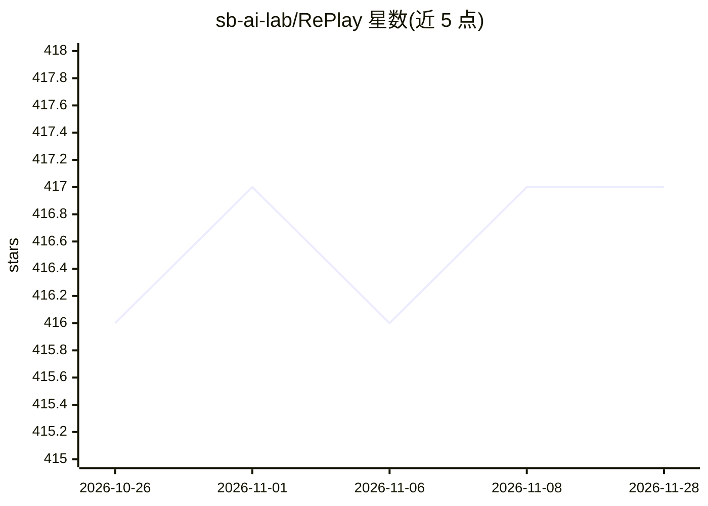

# sb-ai-lab/RePlay

⭐ 417 · Python · Apache-2.0 · 推送 2026-11-24 · [GitHub](https://github.com/sb-ai-lab/RePlay) · [官网](https://sb-ai-lab.github.io/RePlay/) · 组织维护

**推荐系统全流程开发与评估框架：数据处理到上线**

覆盖推荐系统流水线全生命周期的 Python 框架：提供数据预处理与切分、多类推荐模型（SOTA 到基线，含 SASRec、BERT4Rec、TwoTower、bandit 等）、超参数优化、评估指标、模型集成与两级模型组合，并支持从离线实验到在线生产环境的迁移。通过 PySpark 集成实现分布式集群计算，以 pip 包形式分发，核心包与 PySpark/PyTorch 功能通过 extras 分离安装。维护方发布多篇 RecSys/CIKM 论文与示例 notebook。

## 筛选速览

| 维度 | 判定 | 备注 |
|---|---|---|
| AI 角色 | `ai-native` | 本体是模型或模型工具 |
| 许可风险 | `permissive` | Apache-2.0 |
| 部署形态 | `library` | 以包/库形式分发 |
| 模型依赖 | — | README 未给出锁定关系 |
| 硬件要求 | `cpu-ok` | |
| 安装摩擦 | `low` | 无编译、无系统依赖或容器化 |
| 成熟度 | — | 结构信号不足 |

## 能力要点

- 覆盖数据预处理、训练、评估、集成到上线全流程
- 支持 SASRec/BERT4Rec/TwoTower 等 transformer 模型及 bandit 模型
- PySpark 分布式计算，支持大规模数据
- CPU/GPU/多 GPU 兼容，支持 Optuna 调参与 OpenVINO 模型编译

## 适用场景

- 为业务数据训练和对比多种推荐模型
- 在集群上分布式训练大规模推荐模型
- 用统一指标体系评估推荐算法效果
- 将离线实验模型迁移到生产环境

## 场景标签

`推荐系统` · 领域:学习与行业

## 证据(README 行号)

> L11: RePlay is an advanced framework designed to facilitate the development and evaluation of recommendation systems. It
> L15: * **Wide Range of Recommendation Models:** Enables building of recommendation models from State-of-the-Art to commo
> L23: 2. **Cluster Computing Integration:** Integrating with PySpark for distributed computing, enabling scalability for 

## 星数曲线

2026-10-26 416 → 2026-11-28 417（+1）

---
*卡片 v1 · prompt 1.4 · 生成 2026-11-25 · 置信度 high · 依据 README sha `20e0b8cb6b5f` · [字段定义](../../DATASET.md)*
