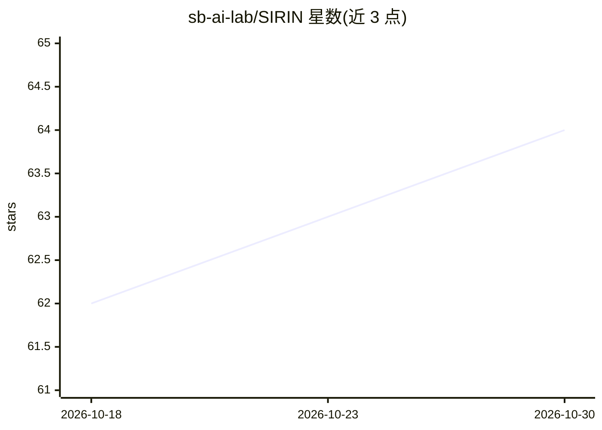

# sb-ai-lab/SIRIN

⭐ 64 · Python · NOASSERTION · 推送 2026-09-28 · [GitHub](https://github.com/sb-ai-lab/SIRIN) · [官网](https://hf.co/spaces/parchiev/SIRIN) · 组织维护

**检测 LLM 输出幻觉与问题可答性的 Python 库**

面向科研与工程用户的幻觉检测库：在给定上下文下判定 LLM 输出是否含矛盾或无依据内容，并检测提问能否由上下文回答；支持序列级与 token 级两种粒度，提供 probing、llm-as-a-judge、不确定性量化三类检测器，可读取冻结模型的隐藏状态、注意力等内部特征，后端支持 HuggingFace（白盒）与 OpenAI API（黑盒）。附带 Streamlit UI 与长上下文分段聚合（含 LangChain 分块策略）。以 pip 源码安装方式提供。

## 筛选速览

| 维度 | 判定 | 备注 |
|---|---|---|
| AI 角色 | `ai-ecosystem` | LLM/agent 周边工具 |
| 许可风险 | `none` | NOASSERTION |
| 部署形态 | `library` | 以包/库形式分发 |
| 模型依赖 | — | README 未给出锁定关系 |
| 硬件要求 | — | 无带数字的原话,不猜 |
| 安装摩擦 | `low` | 无编译、无系统依赖或容器化 |
| 成熟度 | — | 结构信号不足 |

## 能力要点

- 幻觉检测与查询可答性检测双任务，序列级与 token 级两种粒度
- probing / llm-as-a-judge / 不确定性量化三类检测器族
- 多种特征处理器：隐藏状态、注意力统计、Lookback Lens、拓扑散度等
- ContextSplitter 长上下文分段检测与多模式聚合

## 适用场景

- 评估 RAG 系统回答是否有上下文依据
- 定位 LLM 输出中具体幻觉片段
- 在缺少标注数据时用代理标签自举训练检测器

## 场景标签

`模型评测` · 领域:评测与运维

## 证据(README 行号)

> L11: SIRIN is a Python library for detecting and analyzing contextual inconsistencies in systems that use LLMs. The libr
> L13: Both tasks are supported at **sequence-level** and **token-level** granularities, enabling researchers and practiti

## 星数曲线

2026-10-18 62 → 2026-10-30 64（+2）

---
*卡片 v1 · prompt 1.4 · 生成 2026-10-24 · 置信度 high · 依据 README sha `1949e91cbf8c` · [字段定义](../../DATASET.md)*
