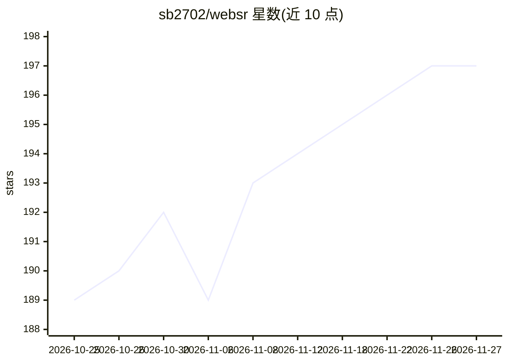

# sb2702/websr

⭐ 197 · Jupyter Notebook · MIT · 推送 2026-11-15 · [GitHub](https://github.com/sb2702/websr) · [官网](https://websr.dev) · 个人维护

**给 Web 开发者在浏览器里实时超分视频与图像的 JS 库**

面向网页端的开源 JavaScript 库/SDK，基于 WebGPU compute shader 对视频帧与图像执行实时超分辨率放大，支持多档网络规模（XS 到 L）及 Real-ESRGAN x4v3 与由其蒸馏的 UNet。针对大图自动分块以适应显存预算，支持 f16 计算、运行时切换网络、OffscreenCanvas worker 线程处理；无 WebGPU 时可回退到同 API 的 WebGL2 后端。权重经 jsDelivr CDN 或 Hugging Face 镜像加载。README 声明项目处于开发早期，API 可能变动，不建议用于生产。

## 筛选速览

| 维度 | 判定 | 备注 |
|---|---|---|
| AI 角色 | `ai-native` | 本体是模型或模型工具 |
| 许可风险 | `permissive` | MIT |
| 部署形态 | `library` | 以包/库形式分发 |
| 模型依赖 | — | README 未给出锁定关系 |
| 硬件要求 | — | 无带数字的原话,不猜 |
| 安装摩擦 | `low` | 无编译、无系统依赖或容器化 |
| 成熟度 | `idea` | |

## 能力要点

- 基于 WebGPU compute shader 的实时视频/图像超分，含 WebGL2 回退后端
- 多种网络规模（XS–L）与 Anime4K、Real-ESRGAN x4v3 权重，覆盖动画/真实/3D 内容
- 自动分块适配 GPU 显存限制，支持 f16 计算与 OffscreenCanvas worker 处理
- 内置 TFLite 内容检测（动画/真人内容分类）与自定义训练流程

## 适用场景

- 在网页播放器中对视频做实时超分以改善低码率画质
- 对用户上传的图片在浏览器本地放大而无需服务器
- WebRTC 场景下在浏览器端提升视频清晰度
- 为动漫/真人内容自动选择匹配的超分网络

## 场景标签

`图像视频处理` · 领域:感知与多模态

## 证据(README 行号)

> L3: A free and open-source Javascript library / SDK for running practical, real-time AI Upscaling of videos and images o
> L14: - ✅ Real-time AI upscaling using WebGPU compute shaders

## 星数曲线

2026-10-25 189 → 2026-11-27 197（+8）

---
*卡片 v1 · prompt 1.4 · 生成 2026-11-25 · 置信度 high · 依据 README sha `6037b9c82065` · [字段定义](../../DATASET.md)*
