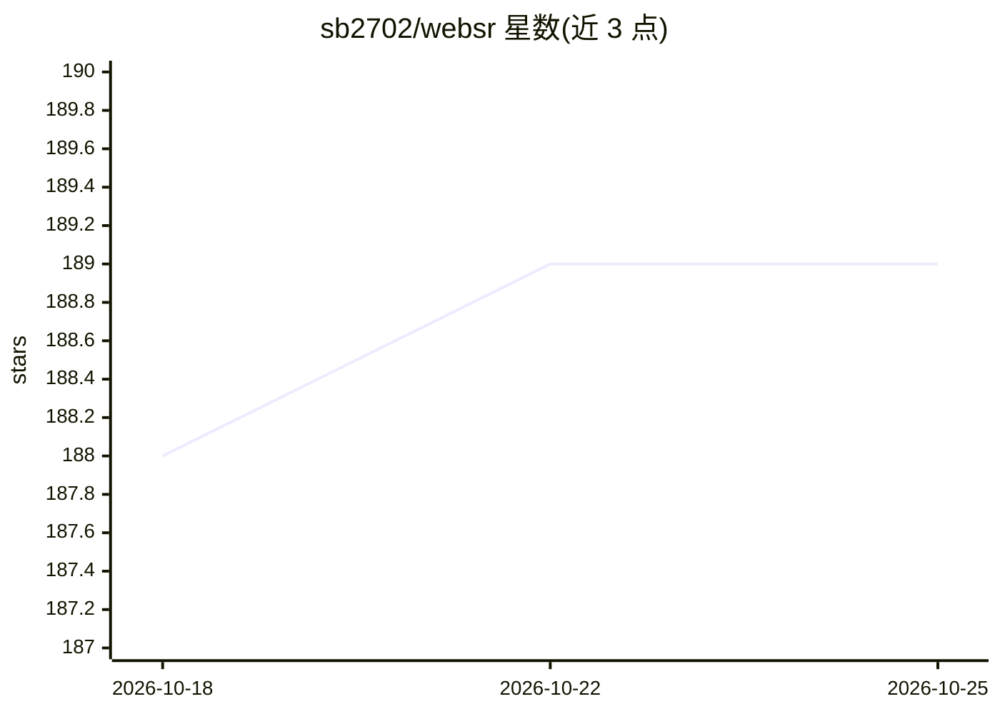

# sb2702/websr

⭐ 190 · Jupyter Notebook · MIT · 推送 2026-09-18 · [GitHub](https://github.com/sb2702/websr) · [官网](https://websr.dev) · 个人维护

**浏览器内实时 AI 超分辨率 JS 库，用 WebGPU 放大视频/图像**

面向 Web 开发者的 JavaScript/SDK 库，通过手写 WebGPU compute shader 在浏览器中实时运行神经网络超分辨率，将视频帧/图像放大后绘制到 canvas。提供 3 种网络规模（Small/Medium/Large）与动画、实景、3D 三类预训练权重，支持 OffscreenCanvas worker 线程处理、运行时动态切换网络、手动渲染控制，并附带 TensorFlow 自定义训练管线与权重导出工具。README 自述项目尚在开发中，API 可能在版本间变化，不建议在生产环境使用。

## 筛选速览

| 维度 | 判定 | 备注 |
|---|---|---|
| AI 角色 | `ai-native` | 本体是模型或模型工具 |
| 许可风险 | `permissive` | MIT |
| 部署形态 | `library` | 以包/库形式分发 |
| 模型依赖 | — | README 未给出锁定关系 |
| 硬件要求 | — | 无带数字的原话,不猜 |
| 安装摩擦 | `low` | 无编译、无系统依赖或容器化 |
| 成熟度 | `idea` | |

## 能力要点

- WebGPU compute shader 实现的 CNN 实时视频超分辨率
- 三种网络规模与动画/实景/3D 内容预训练权重
- OffscreenCanvas worker 线程处理与运行时网络切换
- 附带自定义训练管线（Jupyter notebooks）与权重导出工具

## 适用场景

- 在 Web 视频应用中实时提升低分辨率视频画质
- WebRTC 场景下带宽受限时以低码率传输、本地放大补画质
- 针对特定内容（如医疗影像、特定美术风格）训练定制超分模型

## 场景标签

`图像视频处理` · 领域:感知与多模态

## 证据(README 行号)

> L3: A free and open-source Javascript library / SDK for running practical, real-time AI Upscaling of videos and images o
> L14: - ✅ Real-time AI upscaling using WebGPU compute shaders
> L114: WebSR uses hand-written WebGPU shaders to implement Convolutional Neural Networks (like this one from Anime4K).

## 星数曲线

2026-10-18 188 → 2026-10-25 189（+1）

---
*卡片 v1 · prompt 1.4 · 生成 2026-10-22 · 置信度 high · 依据 README sha `00a4729efbdb` · [字段定义](../../DATASET.md)*
