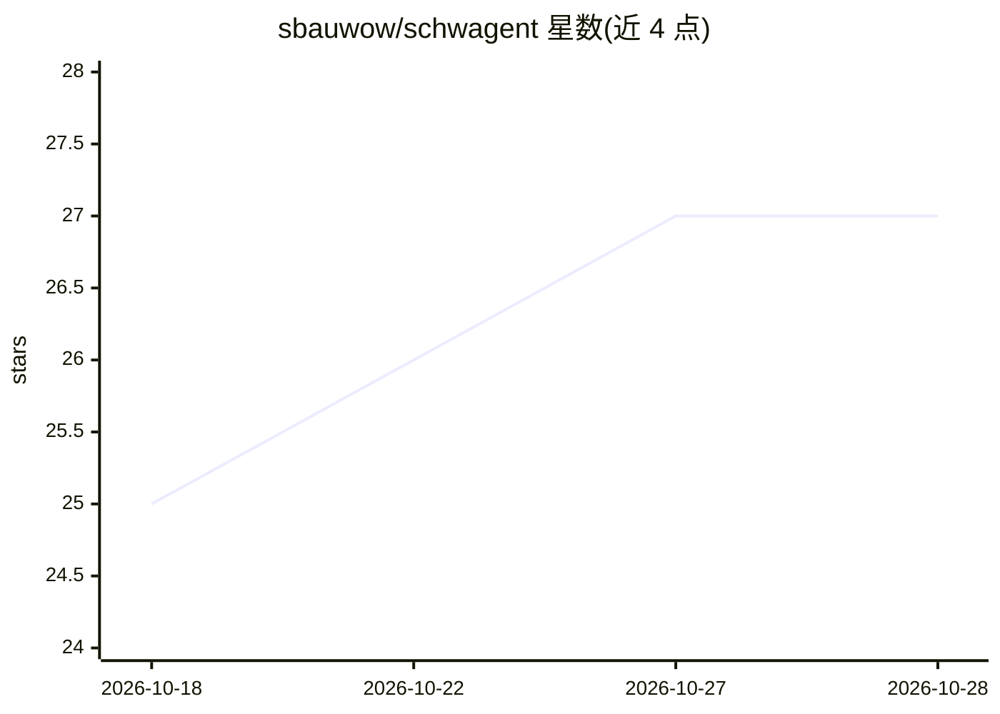

# sbauwow/schwagent

⭐ 27 · Python · MIT · 推送 2026-09-25 · [GitHub](https://github.com/sbauwow/schwagent) · 个人维护

**面向 Charles Schwab API 的自动化量化交易 agent**

非官方的 Charles Schwab 自动化交易代理：通过双 OAuth2 应用（Trader + Market Data）接入 Schwab API，扫描自选列表并执行 ETF 轮动、动量、均值回归、趋势跟踪、日内 scalp、复合等多策略，支持真实下单。附带 Web 仪表盘、回测验证（Monte Carlo/Bootstrap Sharpe/Walk-Forward）、期权分析（Black-Scholes + Greeks）、组合优化、35+ 技术指标、SEC EDGAR 查询与 Telegram 机器人控制。AI 部分：LLM overlay（本地 Ollama 提供宏观置信度调节仓位）、23 条技能库与 DAG 多 agent 委员会。默认 DRY_RUN，两层开关（全局 + 每策略）才可实盘。需 Python 3.11+ 与 uv，从源码安装并登记 Schwab 凭据。

## 筛选速览

| 维度 | 判定 | 备注 |
|---|---|---|
| AI 角色 | `ai-enhanced` | 去掉 AI 部分产品仍成立 |
| 许可风险 | `permissive` | MIT |
| 部署形态 | `None` |  |
| 模型依赖 | local-ok | 支持本地模型 |
| 硬件要求 | — | 无带数字的原话,不猜 |
| 安装摩擦 | `low` | 无编译、无系统依赖或容器化 |
| 成熟度 | — | 结构信号不足 |

## 能力要点

- 双 OAuth2 应用接入 Schwab Trader 与 Market Data API
- DRY_RUN 全局开关 + 每策略 LIVE 开关的两层安全模型
- 回测 + Monte Carlo/Bootstrap/Walk-Forward 验证与期权 Black-Scholes/Greeks 分析
- LLM overlay：本地 Ollama 输出宏观置信度调节 ETF 轮动仓位
- Telegram 机器人推送告警、交易审批与远程 kill switch

## 适用场景

- 我在 Schwab 账户上跑量化策略并先纸面验证
- 我需要回测与统计验证评估策略表现
- 我通过 Telegram 远程查看持仓、盈亏并控制 kill switch

## 场景标签

`金融量化` `多智能体` · 领域:Agent 开发

## 证据(README 行号)

> L15: Automated equity, ETF, and options trading agent for Charles Schwab. Connects via dual OAuth2 apps (account + marke
> L184: **LLM overlay** — when `LLM_ENABLED=true`, the local Ollama model provides a macro confidence score (0-1) that sca

## 星数曲线

2026-10-18 25 → 2026-10-28 27（+2）

---
*卡片 v1 · prompt 1.4 · 生成 2026-10-26 · 置信度 high · 依据 README sha `ba41fde589d4` · [字段定义](../../DATASET.md)*
