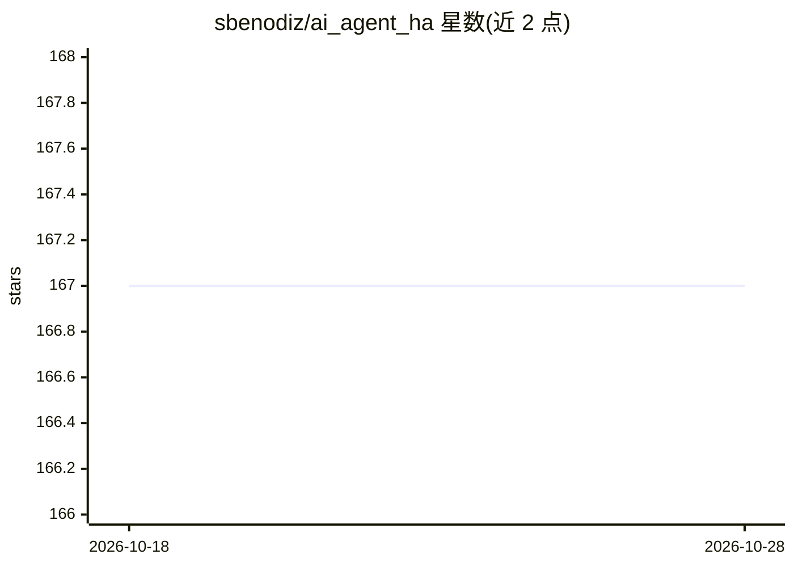

# sbenodiz/ai_agent_ha

⭐ 168 · Python · MIT · 推送 2026-10-27 · [GitHub](https://github.com/sbenodiz/ai_agent_ha) · 个人维护

**Home Assistant 集成：用自然语言生成自动化与仪表盘的 AI agent**

Home Assistant 自定义组件，将实例连接到多种 AI 提供商（OpenAI、Gemini、Anthropic、OpenRouter、Alter、z.ai、Llama、本地 Ollama 及 OpenAI 兼容端点），通过聊天界面把用户请求翻译为 Home Assistant 操作：创建自动化、生成按房间/功能组织的仪表盘、读取实体状态与历史、天气、人员位置等数据。自动化建议需用户批准后写入。通过 HACS 或手动复制 custom_components 文件夹安装，两步配置选择提供商并填入 API key。

## 筛选速览

| 维度 | 判定 | 备注 |
|---|---|---|
| AI 角色 | `ai-native` | 本体是模型或模型工具 |
| 许可风险 | `permissive` | MIT |
| 部署形态 | `desktop` | 安装包/桌面程序 |
| 模型依赖 | local-ok | 支持本地模型 |
| 硬件要求 | — | 无带数字的原话,不猜 |
| 安装摩擦 | `low` | 无编译、无系统依赖或容器化 |
| 成熟度 | — | 结构信号不足 |

## 能力要点

- 支持 7 家云 AI 提供商及本地 Ollama/OpenAI 兼容端点
- 自然语言创建自动化（需人工批准）与仪表盘
- 可访问实体状态、历史、天气、设备与区域信息
- 通过 HACS 安装，提供聊天界面侧边栏面板

## 适用场景

- 对智能家居说'日落时开灯'让 AI 生成自动化
- 用自然语言生成安防/能耗/温控仪表盘
- 通过对话查询家中设备状态与历史数据

## 场景标签

`聊天机器人` `代码生成` · 领域:编码与开发

## 证据(README 行号)

> L3: A powerful Home Assistant custom integration that connects your Home Assistant instance with multiple AI providers (
> L25: - 🏠 **Smart Home Control**: Turn lights on/off, control climate, and manage devices
> L26: - ⚡ **Automation Creation**: Automatically create automations based on natural language
> L27: - 📋 **Dashboard Creation**: Create and customize Home Assistant dashboards through natural language

## 星数曲线

2026-10-18 167 → 2026-10-28 167（+0）

---
*卡片 v1 · prompt 1.4 · 生成 2026-10-22 · 置信度 high · 依据 README sha `fa82f353d5d5` · [字段定义](../../DATASET.md)*
