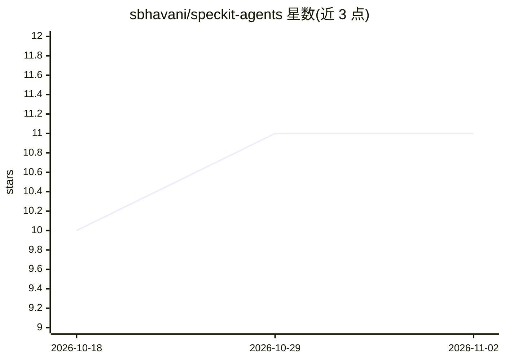

# sbhavani/speckit-agents

⭐ 11 · Python · MIT · 推送 2026-07-09 · [GitHub](https://github.com/sbhavani/speckit-agents) · 个人维护

**PM+Dev 双智能体经 Mattermost 协作的自主功能交付编排系统**

基于 Claude Code CLI 的多智能体编排系统：PM 智能体读取项目 PRD 建议待实现功能，人类在 Mattermost 聊天中批准或否决，Dev 智能体随后执行 Spec Kit 的 specify/plan/tasks/implement 流程，在隔离 worktree 中完成实现并创建 PR。人类可在任一检查点介入。提供 orchestrator CLI（含 dry-run、resume、多项目等旗标）、Docker Compose 部署与可选 Redis Streams 并行 worker。面向希望以人机协同方式自动交付功能、且能自托管 Mattermost 的开发团队。

## 筛选速览

| 维度 | 判定 | 备注 |
|---|---|---|
| AI 角色 | `ai-native` | 本体是模型或模型工具 |
| 许可风险 | `permissive` | MIT |
| 部署形态 | `self-host` | docker 或自建部署 |
| 模型依赖 | locked-api |  |
| 硬件要求 | — | 无带数字的原话,不猜 |
| 安装摩擦 | `low` | 无编译、无系统依赖或容器化 |
| 成熟度 | — | 结构信号不足 |

## 能力要点

- PM 智能体读 PRD 优先级建议，Dev 智能体跑 Spec Kit 全流程
- Mattermost 双机器人通道实现人在环路的批准/否决与介入
- worktree 隔离生成干净 PR，学习记录回写 agent 记忆文件
- CLI 旗标覆盖 dry-run/resume/auto-approve/多项目，Docker Compose 部署

## 适用场景

- 在 Mattermost 里批准 PM 建议、让 Dev 智能体自动实现并提 PR
- 按 PRD 驱动多项目批量交付功能（--all-projects --loop）
- 以人在环方式监督智能体完成 spec 到实现的完整流程

## 场景标签

`多智能体` `编码 Agent` · 领域:Agent 开发

## 证据(README 行号)

> L5: A multi-agent orchestration system where a **Product Manager agent** and a **Developer agent** collaborate to ship f
> L7: Both agents are powered by Claude Code CLI. The Developer agent uses **Spec Kit** for structured specification and i
> L42: 🦊 **Dev Agent** runs the Spec Kit workflow:

## 星数曲线

2026-10-18 10 → 2026-11-02 11（+1）

---
*卡片 v1 · prompt 1.4 · 生成 2026-11-01 · 置信度 high · 依据 README sha `fe11482b7273` · [字段定义](../../DATASET.md)*
