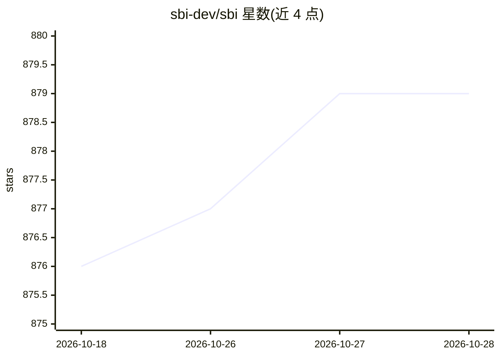

# sbi-dev/sbi

⭐ 880 · Python · Apache-2.0 · 推送 2026-10-28 · [GitHub](https://github.com/sbi-dev/sbi) · [官网](https://sbi.readthedocs.io) · 组织维护

**Python 仿真推断库：用贝叶斯方法估计仿真器参数后验分布**

面向研究者与从业者的 Python 仿真推断（SBI）包：给定仿真器与观测数据，基于机器学习估计参数的完整后验分布，量化不确定性与参数交互。实现 NPE/NLE/NRE/NVI/MNLE 等多类算法，分摊式方法可跨观测复用估计器，序列式方法优化仿真次数；提供低层与高层两种接口，并内置后验验证与可视化工具。需 Python 3.11+，GPU 非必需；Pyro/PyMC 采样器为可选安装。Apache-2.0 许可，NumFOCUS 附属项目。

## 筛选速览

| 维度 | 判定 | 备注 |
|---|---|---|
| AI 角色 | `ai-native` | 本体是模型或模型工具 |
| 许可风险 | `permissive` | Apache-2.0 |
| 部署形态 | `library` | 以包/库形式分发 |
| 模型依赖 | — | README 未给出锁定关系 |
| 硬件要求 | — | 无带数字的原话,不猜 |
| 安装摩擦 | `low` | 无编译、无系统依赖或容器化 |
| 成熟度 | — | 结构信号不足 |

## 能力要点

- 估计仿真器参数的完整后验分布并量化不确定性
- 覆盖 NPE/NLE/NRE/NVI/MNLE 多类神经推断算法
- 分摊式与序列式两类推断方法
- 内置后验验证与绘图分析工具

## 适用场景

- 为科学仿真模型做贝叶斯参数估计
- 在多个观测上复用已训练的后验估计器
- 分析和可视化推断得到的后验分布

## 场景标签

 · 领域:科学计算/统计推断

## 证据(README 行号)

> L15: `sbi` is a Python package for simulation-based inference, designed to meet the needs of
> L19: With `sbi`, you can perform parameter inference using Bayesian inference: Given a
> L20: simulator that models a real-world process, SBI estimates the full posterior

## 星数曲线

2026-10-18 876 → 2026-10-28 879（+3）

---
*卡片 v1 · prompt 1.4 · 生成 2026-10-21 · 置信度 high · 依据 README sha `48699251abce` · [字段定义](../../DATASET.md)*
