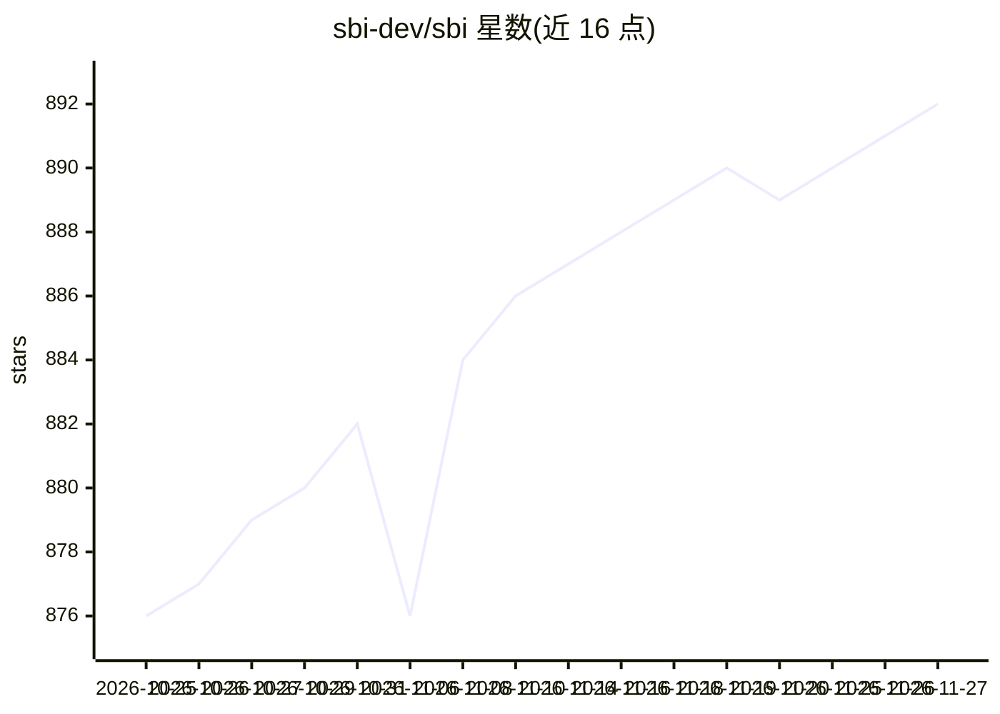

# sbi-dev/sbi

⭐ 892 · Python · Apache-2.0 · 推送 2026-11-26 · [GitHub](https://github.com/sbi-dev/sbi) · [官网](https://sbi.readthedocs.io) · 组织维护

**面向科研人员的仿真贝叶斯参数推断 Python 库**

基于 PyTorch 的 simulation-based inference 库：给定模拟器与观测数据，估计模拟器参数的完整后验分布并量化不确定性。提供低层细粒度控制与高层简易接口两级 API，实现 NPE/SNPE、NLE/SNLE、NRE/SNRE、SNVI、MNLE、FMPE、NPSE、Simformer 等算法，分为摊销式与序贯式两类；附带后验验证、绘图与分析工具。可选集成 Pyro/PyMC 的 MCMC 采样器，需 Python 3.11+。

## 筛选速览

| 维度 | 判定 | 备注 |
|---|---|---|
| AI 角色 | `ai-native` | 本体是模型或模型工具 |
| 许可风险 | `permissive` | Apache-2.0 |
| 部署形态 | `library` | 以包/库形式分发 |
| 模型依赖 | — | README 未给出锁定关系 |
| 硬件要求 | — | 无带数字的原话,不猜 |
| 安装摩擦 | `low` | 无编译、无系统依赖或容器化 |
| 成熟度 | — | 结构信号不足 |

## 能力要点

- 实现多种推断算法：NPE/SNPE、NLE、NRE、SNVI、MNLE、FMPE、NPSE、Simformer
- 低层细粒度控制与高层易用接口两级 API
- 内置后验验证工具与绘图分析工具
- 可选 Pyro/PyMC MCMC 采样器扩展

## 适用场景

- 对模拟器模型做参数后验估计与不确定性量化
- 复用训练好的后验估计器对新观测做摊销推断
- 模拟预算受限时用序贯方法减少模拟次数
- 对推断得到的后验做验证与可视化分析

## 场景标签

`科研工具` · 领域:学习与行业

## 证据(README 行号)

> L19: With `sbi`, you can perform parameter inference using Bayesian inference: Given a
> L36: In addition, `sbi` supports a wide range of state-of-the-art inference algorithms (see
> L54: from sbi.inference import NPE

## 星数曲线

2026-10-25 876 → 2026-11-27 892（+16）

---
*卡片 v1 · prompt 1.4 · 生成 2026-11-26 · 置信度 high · 依据 README sha `493f9f0727cf` · [字段定义](../../DATASET.md)*
