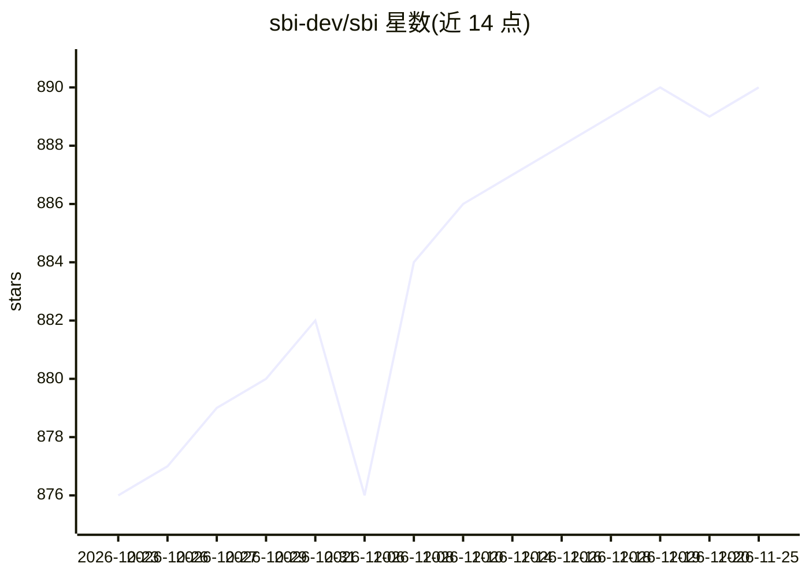

# sbi-dev/sbi

⭐ 890 · Python · Apache-2.0 · 推送 2026-11-23 · [GitHub](https://github.com/sbi-dev/sbi) · [官网](https://sbi.readthedocs.io) · 组织维护

**面向科研与工程的贝叶斯参数推断库**

提供基于模拟的贝叶斯参数推断：输入模拟器参数与输出样本，估计后验分布并量化不确定性。实现 NPE/NLE/NRE/NVI/MNLE 等方法族，支持摊销式与序贯两种训练模式。提供高级接口（几行代码完成推断）与底层接口（可调节训练细节），附带后验校验与可视化诊断工具。可选集成 Pyro/PyMC MCMC 采样器。

## 筛选速览

| 维度 | 判定 | 备注 |
|---|---|---|
| AI 角色 | `ai-native` | 本体是模型或模型工具 |
| 许可风险 | `permissive` | Apache-2.0 |
| 部署形态 | `library` | 以包/库形式分发 |
| 模型依赖 | — | README 未给出锁定关系 |
| 硬件要求 | — | 无带数字的原话,不猜 |
| 安装摩擦 | `low` | 无编译、无系统依赖或容器化 |
| 成熟度 | — | 结构信号不足 |

## 能力要点

- 实现 NPE、NLE、NRE、NVI、MNLE 等多种推断算法
- 支持摊销式（amortized）与序贯（sequential）两种模式
- 内置后验校验与绘图诊断工具
- 可选集成 Pyro/PyMC 采样器

## 适用场景

- 给定物理/生物模拟器，估计其参数的后验分布
- 需要量化参数不确定性并检验后验质量的推断任务
- 同一模拟器多次观测下复用训练好的后验估计器

## 场景标签

`科研工具` · 领域:学习与行业

## 证据(README 行号)

> L15: `sbi` is a Python package for simulation-based inference, designed to meet the needs of
> L19: With `sbi`, you can perform parameter inference using Bayesian inference: Given a
> L36: In addition, `sbi` supports a wide range of state-of-the-art inference algorithms (see

## 星数曲线

2026-10-23 876 → 2026-11-25 890（+14）

---
*卡片 v1 · prompt 1.4 · 生成 2026-11-24 · 置信度 high · 依据 README sha `a5978a395d82` · [字段定义](../../DATASET.md)*
