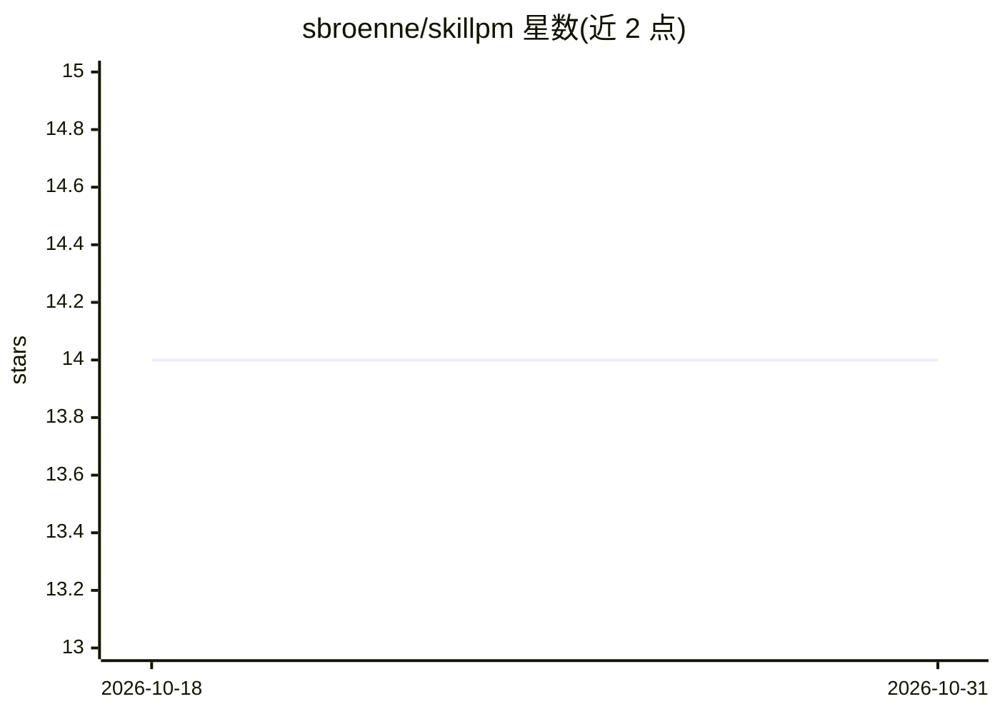

# sbroenne/skillpm

⭐ 14 · TypeScript · MIT · 推送 2026-10-30 · [GitHub](https://github.com/sbroenne/skillpm) · [官网](https://skillpm.dev) · 个人维护

**基于 npm 的 Agent Skills 包管理器：发布、安装、版本与接入**

面向 AI agent 技能的命令行包管理工具，把 Agent Skills 纳入 npm 体系：技能作为 npm 包发布到 npmjs.org，由 npm 处理依赖解析、semver、lockfile 与审计；安装后 skillpm 扫描 node_modules（含嵌套依赖）中的 skills/*/SKILL.md，通过上游 skills CLI 把技能接入 agent 目录。提供 install/uninstall/list/init/publish/sync 命令，支持 npm workspace monorepo；非 npm 来源（Git、全局安装）需用上游 CLI。需要 Node.js 22.20.0+，发布需 PATH 中的 skills-ref 校验器（Python），安装与同步不需要。

## 筛选速览

| 维度 | 判定 | 备注 |
|---|---|---|
| AI 角色 | `ai-ecosystem` | LLM/agent 周边工具 |
| 许可风险 | `permissive` | MIT |
| 部署形态 | `library` | 以包/库形式分发 |
| 模型依赖 | — | README 未给出锁定关系 |
| 硬件要求 | — | 无带数字的原话,不猜 |
| 安装摩擦 | `low` | 无编译、无系统依赖或容器化 |
| 成熟度 | — | 结构信号不足 |

## 能力要点

- 技能经 npm 发布/安装/版本管理（semver、lockfile、审计）
- 扫描 node_modules 含嵌套依赖中的 SKILL.md 并接入 agent 目录
- skillpm sync 支持 npm workspace monorepo 中的一方技能包
- 发布前校验 Agent Skills 规范，链接失败返回非零退出码

## 适用场景

- 把可复用的 agent 技能作为 npm 包发布和分发
- 在项目中安装技能并自动接入支持的 agent 目录
- monorepo 中编辑本地技能包后重新生成接入链接

## 场景标签

`Agent 框架` · 领域:Agent 开发

## 证据(README 行号)

> L7: The Agent Skills spec defines what a skill is, but not how to publish, install, version, or share it through npm. `s
> L38: 1. **npm install** — npm handles resolution, download, lockfile, and `node_modules/`
> L39: 2. **Scan** — skillpm scans `node_modules/`, including nested dependencies, for packages containing `skills/*/SKILL

## 星数曲线

2026-10-18 14 → 2026-10-31 14（+0）

---
*卡片 v1 · prompt 1.4 · 生成 2026-10-31 · 置信度 high · 依据 README sha `04d217e89b39` · [字段定义](../../DATASET.md)*
