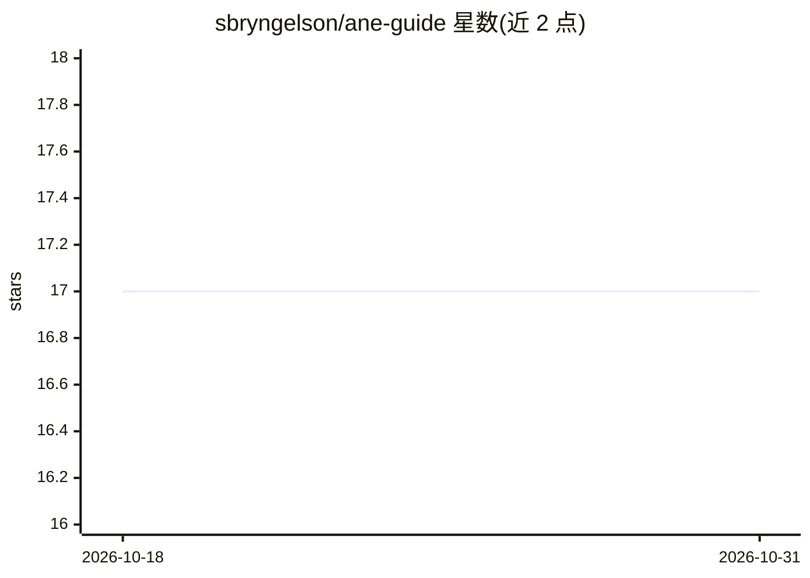

# sbryngelson/ane-guide

⭐ 17 · Shell · 推送 2026-10-15 · [GitHub](https://github.com/sbryngelson/ane-guide) · [官网](https://ane-guide.readthedocs.io) · 个人维护

**Apple 神经引擎（ANE）架构与编程的逆向工程参考手册**

一部关于 Apple Neural Engine 的技术参考指南，覆盖 A11 及 M1 之后 Apple 芯片中固定功能矩阵加速器的数据通路与 roofline、Core ML 之下的调度路径、编译器与程序格式、内核驱动、固件与命令协议。内容基于测量与反编译，每个实质性论断标注为 measured、decompile-derived 或 predicted。指南说明所述直接路径在用户态可达但非 Apple 公开接口，具有版本脆弱性且不可再分发，正式发布软件的受支持路径仍是 Core ML。以网页版、PDF 与 arXiv 论文形式提供，采用 CC BY 4.0 许可。

## 筛选速览

| 维度 | 判定 | 备注 |
|---|---|---|
| AI 角色 | `ai-knowledge` | 知识聚合/清单类 |
| 许可风险 | `none` | — |
| 部署形态 | `None` |  |
| 模型依赖 | — | README 未给出锁定关系 |
| 硬件要求 | — | 无带数字的原话,不猜 |
| 安装摩擦 | `low` | 无编译、无系统依赖或容器化 |
| 成熟度 | `idea` | |

## 能力要点

- 基于测量与反编译记录 ANE 数据通路、编译器、驱动与固件
- 每条实质性论断标注 measured/decompile-derived/predicted
- 前半部署调优模型，后半为参考表、结构与寄存器映射
- 提供网页版、PDF 与 arXiv 论文（arXiv:2606.22283）

## 适用场景

- 研究 Apple Neural Engine 的底层架构与性能特性
- 在固定系统版本上做 ANE 的测量与设备端实验
- 了解 Core ML 之下的调度路径与私有程序格式

## 场景标签

 · 领域:硬件架构/机器学习加速器文档

## 证据(README 行号)

> L8: This guide documents the Apple Neural Engine (ANE), the fixed-function matrix accelerator built into Apple silicon f
> L9: It reports what Apple's public surface does not: the datapath and roofline, the dispatch route below Core ML, the co

## 星数曲线

2026-10-18 17 → 2026-10-31 17（+0）

---
*卡片 v1 · prompt 1.4 · 生成 2026-10-29 · 置信度 high · 依据 README sha `0c34f496315a` · [字段定义](../../DATASET.md)*
