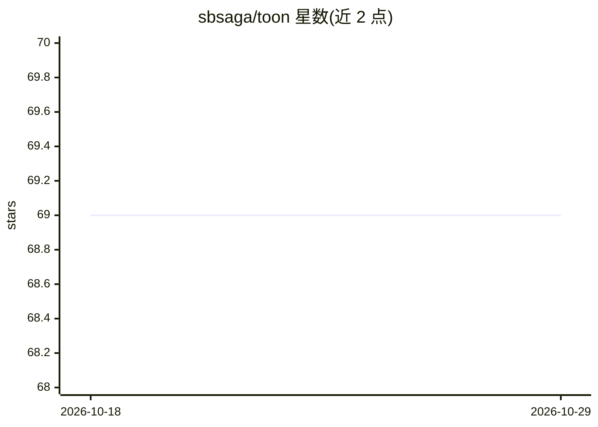

# sbsaga/toon

⭐ 69 · PHP · MIT · 推送 2026-04-19 · [GitHub](https://github.com/sbsaga/toon) · [官网](https://packagist.org/packages/sbsaga/toon) · 个人维护

**Laravel 包：JSON ⇄ TOON 紧凑格式转换，压缩 AI 提示词 token**

面向 Laravel 9+ / PHP 8.1+ 的 composer 包，提供 JSON 或 PHP 数组与 TOON 文本格式之间的编码/解码。TOON 通过合并重复结构（如同构行集合表）减少字符量，自带基准夹具显示较 JSON 节省 43.1% 字符。使用方式包括 Facade（encode/decode/estimateTokens/diff）、全局辅助函数、Collection 宏、流式逐行编解码和 artisan toon:convert CLI。默认 legacy 兼容模式，可选 modern 模式；支持 Replacer 回调按路径改写值。token 比较为启发式估算。

## 筛选速览

| 维度 | 判定 | 备注 |
|---|---|---|
| AI 角色 | `ai-ecosystem` | LLM/agent 周边工具 |
| 许可风险 | `permissive` | MIT |
| 部署形态 | `None` |  |
| 模型依赖 | — | README 未给出锁定关系 |
| 硬件要求 | — | 无带数字的原话,不猜 |
| 安装摩擦 | `low` | 无编译、无系统依赖或容器化 |
| 成熟度 | — | 结构信号不足 |

## 能力要点

- Toon::encode/decode 双向转换，Facade/辅助函数/Collection 宏/CLI 多入口
- 自带可复现基准（合成夹具，43.1% 字符节省，token 为启发式估算）
- Replacer API 按路径改写值，流式 encodeLines/decodeFromLines
- legacy 默认兼容模式，可选 modern 模式与 strict/delimiter 控制

## 适用场景

- 我在给 ChatGPT/Claude 等 LLM 构造提示词时想压缩重复结构的 JSON 负载
- 我想用紧凑格式保存日志快照和内部结构化数据
- 我需要 Laravel 项目内的 JSON ⇄ 紧凑文本双向转换与 token 估算

## 场景标签

`提示工程` · 领域:Agent 开发

## 证据(README 行号)

> L18: TOON is a Laravel package for converting JSON or PHP arrays into a compact text format that stays readable to human
> L22: - ChatGPT, Gemini, Claude, Mistral, and OpenAI prompt payloads

## 星数曲线

2026-10-18 69 → 2026-10-29 69（+0）

---
*卡片 v1 · prompt 1.4 · 生成 2026-10-24 · 置信度 high · 依据 README sha `8d28c04adaf6` · [字段定义](../../DATASET.md)*
