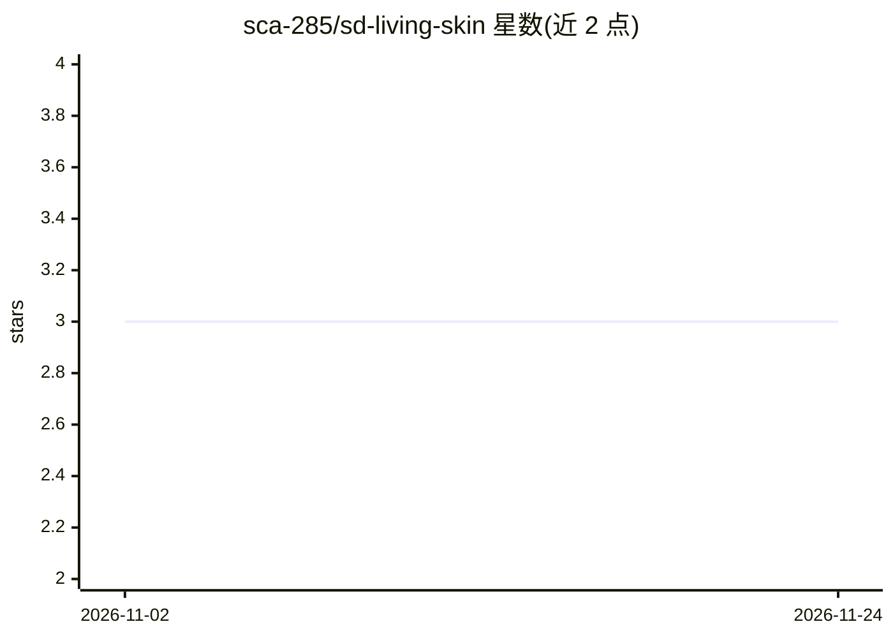

# sca-285/sd-living-skin

⭐ 3 · Python · MIT · 推送 2026-11-09 · [GitHub](https://github.com/sca-285/sd-living-skin) · 个人维护

**Forge 系 WebUI 的皮肤修饰扩展：检测皮肤并调整瑕疵、肤色与纹理**

面向 Forge、reForge 与 Forge Classic (Neo) 的 Stable Diffusion WebUI 扩展。检测人脸与人体上的可见皮肤区域，提供瑕疵、不均匀肤色、细纹理与皱纹的控制项，并试图保留皮肤的自然边界、色调变化与光影。安装器自动补装 facexlib，首次使用时下载约 80 MB 检测模型；提供 8 个预设、PNG 生成信息回存、X/Y/Z plot 轴支持与种子可复现；VRAM 不足时可请求 Forge 卸载模型或退回 CPU 运行。

## 筛选速览

| 维度 | 判定 | 备注 |
|---|---|---|
| AI 角色 | `ai-native` | 本体是模型或模型工具 |
| 许可风险 | `permissive` | MIT |
| 部署形态 | `None` |  |
| 模型依赖 | — | README 未给出锁定关系 |
| 硬件要求 | — | 无带数字的原话,不猜 |
| 安装摩擦 | `low` | 无编译、无系统依赖或容器化 |
| 成熟度 | — | 结构信号不足 |

## 能力要点

- 皮肤检测与蒙版预览（Skin match、Show skin mask）
- 按尺度分离的修饰机制与 8 个可调起点预设
- 参数存入 PNG 生成信息并支持 X/Y/Z plot 与种子复现
- VRAM 检查：可请求 Forge 卸载模型或回退 CPU 运行

## 适用场景

- 为生成的 AI 图像修饰皮肤瑕疵与不均匀色调
- 为过于平滑的生成皮肤恢复细纹理与色调变化
- 多阶段修图流程中放在基础校正与镜头模拟之间

## 场景标签

`图像视频处理` · 领域:感知与多模态

## 证据(README 行号)

> L3: Skin retouching for **Forge, reForge and Forge Classic (Neo)**. Living Skin detects visible skin across the face and
> L9: Install the extension through your WebUI's extension manager or copy this folder into `extensions/`, then restart. T

## 星数曲线

2026-11-02 3 → 2026-11-24 3（+0）

---
*卡片 v1 · prompt 1.4 · 生成 2026-11-21 · 置信度 high · 依据 README sha `32a5adb5943b` · [字段定义](../../DATASET.md)*
