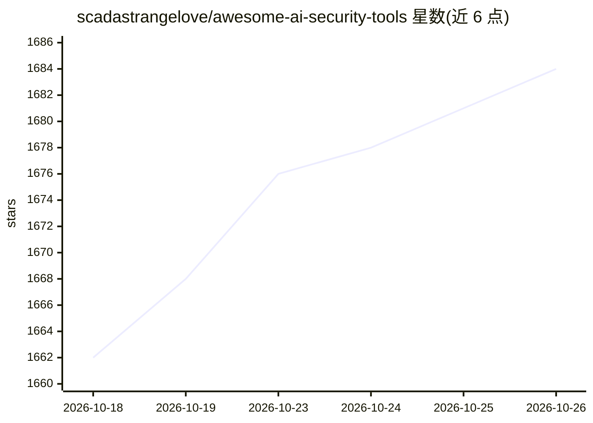

# scadastrangelove/awesome-ai-security-tools

⭐ 1,684 · Python · NOASSERTION · 推送 2026-10-22 · [GitHub](https://github.com/scadastrangelove/awesome-ai-security-tools) · 个人维护

**AI 安全工具策展清单：收录 AI/agent 安全与 AI 辅助安全工具**

面向 AI 安全领域的策展清单（awesome-list），收录开源、研究与商业三类工具，覆盖安全告警自动分诊、AI agent 与编码代理安全审计、MCP 服务器扫描、AI/ML 供应链风险、LLM 红队、逆向与威胁情报等类别。每条目标注类型图例（开源/研究/商业/许可受限）、GitHub star 与最近提交快照，并附 caveat 与相关条目交叉引用；条目内含维护脚本可刷新 star 数据。清单本身以 CC0-1.0 发布，接受 PR。

## 筛选速览

| 维度 | 判定 | 备注 |
|---|---|---|
| AI 角色 | `ai-knowledge` | 知识聚合/清单类 |
| 许可风险 | `none` | NOASSERTION |
| 部署形态 | `library` | 以包/库形式分发 |
| 模型依赖 | — | README 未给出锁定关系 |
| 硬件要求 | — | 无带数字的原话,不猜 |
| 安装摩擦 | `low` | 无编译、无系统依赖或容器化 |
| 成熟度 | — | 结构信号不足 |

## 能力要点

- 按功能类别组织的策展条目，含类型图例与许可风险提示（🟢/🔬/🟠/⚠️）
- 条目附带 caveat 说明与 Related/Sources 交叉引用
- 提供脚本刷新 GitHub star 与 last-commit 快照

## 适用场景

- 为 AI agent/MCP 安全选型时查找扫描与审计工具
- 了解 AI 安全与 AI 辅助安全各细分方向的工具分布
- 按许可类型（开源/商业/受限）筛选可用工具

## 场景标签

`精选清单` · 领域:学习与行业

## 证据(README 行号)

> L3: > A curated list of **public-source, research, and commercial** tools for AI security and AI-assisted cybersecurity 
> L8: **Type legend:** 🟢 public source / open-source · 🔬 research (paper / benchmark / dataset / framework) · 🟠 commercial

## 星数曲线

2026-10-18 1,662 → 2026-10-26 1,684（+22）

---
*卡片 v1 · prompt 1.4 · 生成 2026-10-21 · 置信度 mid · 依据 README sha `5e1b3a29ee1b` · [字段定义](../../DATASET.md)*
