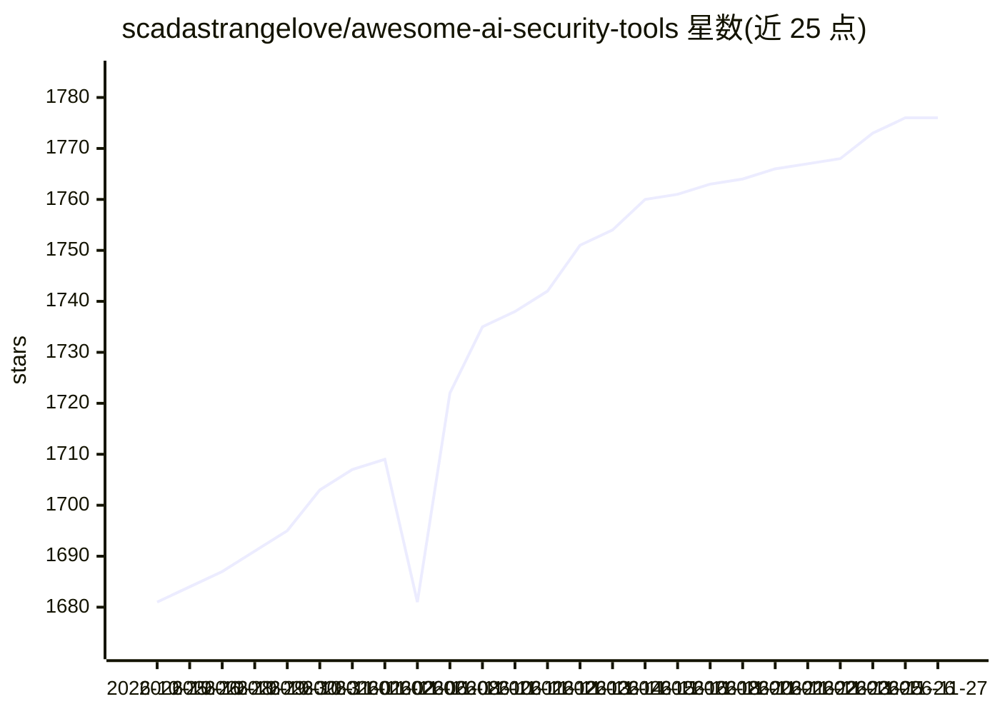

# scadastrangelove/awesome-ai-security-tools

⭐ 1,776 · Python · NOASSERTION · 推送 2026-11-24 · [GitHub](https://github.com/scadastrangelove/awesome-ai-security-tools) · 个人维护

**AI 安全与 AI 辅助网络安全工具的策展清单**

收录公开源、研究与商业三类 AI 安全与 AI 辅助网络安全工具的清单，按自动分诊、Agent 安全、AI/ML 供应链、渗透测试 Agent、AI SAST、LLM 模糊测试、威胁情报、SOC 分诊、逆向工程、LLM 红队等类别组织。每条目标注类型图例（开源/研究/商业/许可受限）并附 ★ 星数与最近提交快照，可用仓库自带脚本刷新 GitHub 指标。许可为 CC0-1.0，接受 PR。

## 筛选速览

| 维度 | 判定 | 备注 |
|---|---|---|
| AI 角色 | `ai-knowledge` | 知识聚合/清单类 |
| 许可风险 | `none` | NOASSERTION |
| 部署形态 | `library` | 以包/库形式分发 |
| 模型依赖 | — | README 未给出锁定关系 |
| 硬件要求 | — | 无带数字的原话,不猜 |
| 安装摩擦 | `low` | 无编译、无系统依赖或容器化 |
| 成熟度 | — | 结构信号不足 |

## 能力要点

- 按 10+ 个安全子类别组织的工具清单，覆盖 Agent 安全、MCP 扫描、LLM 红队等
- 类型图例区分开源/研究/商业/许可受限条目
- GitHub 星数与最近提交快照及刷新脚本
- CC0-1.0 许可并接受 PR 贡献

## 适用场景

- 为安全团队挑选 Agent/MCP 安全扫描工具
- 了解 AI 安全各子领域的工具生态覆盖
- 评估收录工具的许可类型与维护活跃度

## 场景标签

`精选清单` `网络安全` · 领域:学习与行业

## 证据(README 行号)

> L1: # Awesome AI Security Tools Awesome
> L5: > A curated list of **public-source, research, and commercial** tools for AI security and AI-assisted cybersecurity 

## 星数曲线

2026-10-25 1,681 → 2026-11-27 1,776（+95）

---
*卡片 v1 · prompt 1.4 · 生成 2026-11-26 · 置信度 mid · 依据 README sha `d6842538160c` · [字段定义](../../DATASET.md)*
