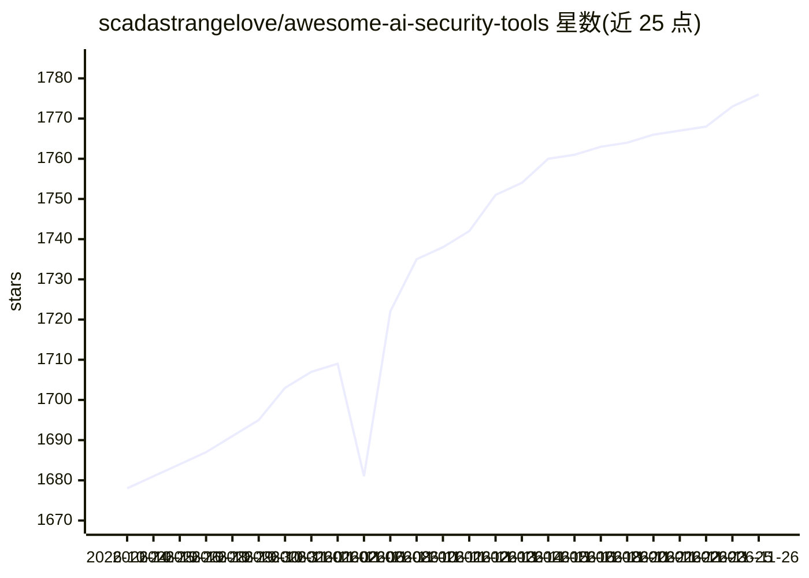

# scadastrangelove/awesome-ai-security-tools

⭐ 1,776 · Python · NOASSERTION · 推送 2026-11-24 · [GitHub](https://github.com/scadastrangelove/awesome-ai-security-tools) · 组织维护

**AI 安全与 AI 辅助网络安全工具的策展清单**

按类别组织的公开来源、研究与商业工具清单，覆盖安全告警自动分诊、Agent 与编码 Agent 安全、AI/ML 供应链、渗透测试 Agent、AI SAST、LLM 驱动模糊测试、威胁情报、SOC/SIEM 分诊、逆向工程、LLM 红队等方向。条目带类型图例区分开源、研究产出、含开放组件的商业产品与许可受限项，GitHub 条目附星标与最近提交快照，脚本可刷新指标，收录条目接受 PR 补充。

## 筛选速览

| 维度 | 判定 | 备注 |
|---|---|---|
| AI 角色 | `ai-knowledge` | 知识聚合/清单类 |
| 许可风险 | `none` | NOASSERTION |
| 部署形态 | `library` | 以包/库形式分发 |
| 模型依赖 | — | README 未给出锁定关系 |
| 硬件要求 | — | 无带数字的原话,不猜 |
| 安装摩擦 | `low` | 无编译、无系统依赖或容器化 |
| 成熟度 | — | 结构信号不足 |

## 能力要点

- 按十余个 AI 安全子类别组织的工具清单
- 类型图例标注开源/研究/商业/许可受限四类
- GitHub 条目附 ★ 星标与 last-commit 快照，可用脚本刷新
- License 采用 CC0-1.0，接受 PR 补充

## 适用场景

- 查找针对 AI Agent、MCP 服务器与技能的安全扫描工具
- 为安全告警自动分诊选型调研候选工具
- 了解 LLM 红队与 AI 供应链安全工具生态

## 场景标签

`精选清单` `网络安全` · 领域:学习与行业

## 证据(README 行号)

> L5: > A curated list of **public-source, research, and commercial** tools for AI security and AI-assisted cybersecurity 
> L10: **Type legend:** 🟢 public source / open-source · 🔬 research (paper / benchmark / dataset / framework) · 🟠 commercia

## 星数曲线

2026-10-24 1,678 → 2026-11-26 1,776（+98）

---
*卡片 v1 · prompt 1.4 · 生成 2026-11-23 · 置信度 mid · 依据 README sha `5a93ef091b2c` · [字段定义](../../DATASET.md)*
