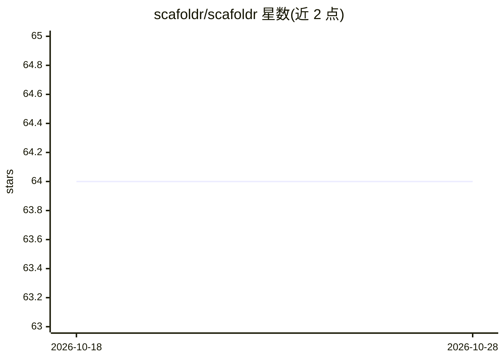

# scafoldr/scafoldr

⭐ 64 · TypeScript · Apache-2.0 · 推送 2026-02-02 · [GitHub](https://github.com/scafoldr/scafoldr) · [官网](https://scafoldr.com/) · 组织维护

**从数据库模式生成后端代码的全栈应用生成工具**

面向开发者的代码脚手架工具：用户以自然语言描述项目想法，由 architect 助手协助设计 DBML 格式的数据库模式，再通过预置模板引擎静态生成后端代码。采用两步方式（AI 辅助模式设计 + 模板化静态生成），支持 Node.js/Express 与 Java/Spring Boot 框架（Python/FastAPI 与 Next.js 在开发中），提供可视化数据库图编辑、代码实时预览与 ZIP 项目下载。本地开发推荐 Docker Compose，也可分离运行 Core API 与 Web 前端，或直接使用 scafoldr.com 网页版。部分功能仍显示 Coming Soon。

## 筛选速览

| 维度 | 判定 | 备注 |
|---|---|---|
| AI 角色 | `ai-ecosystem` | LLM/agent 周边工具 |
| 许可风险 | `permissive` | Apache-2.0 |
| 部署形态 | `self-host` | docker 或自建部署 |
| 模型依赖 | — | README 未给出锁定关系 |
| 硬件要求 | — | 无带数字的原话,不猜 |
| 安装摩擦 | `low` | 无编译、无系统依赖或容器化 |
| 成熟度 | `idea` | |

## 能力要点

- AI 助手辅助设计 DBML 数据库模式
- 模板引擎静态生成后端代码（Node.js/Express、Java/Spring Boot）
- 可视化数据库图编辑与项目 ZIP 下载
- 提供 Docker Compose 本地运行与网页版

## 适用场景

- 描述项目想法快速生成带 CRUD 与鉴权的后端骨架
- 设计并导出数据库模式再生成对应框架代码
- 快速搭建电商、任务管理等示例项目的后端原型

## 场景标签

`代码生成` · 领域:编码与开发

## 证据(README 行号)

> L16: Scafoldr helps developers quickly build backend applications by generating clean, structured code from database sch
> L24: 1. **Schema Design**: Describe your application idea to our architect assistant, which helps you create a proper da
> L25: 2. **Static Generation**: Our templating engine converts your DBML schema into clean backend code using pre-built, 

## 星数曲线

2026-10-18 64 → 2026-10-28 64（+0）

---
*卡片 v1 · prompt 1.4 · 生成 2026-10-24 · 置信度 high · 依据 README sha `aede48da3dec` · [字段定义](../../DATASET.md)*
