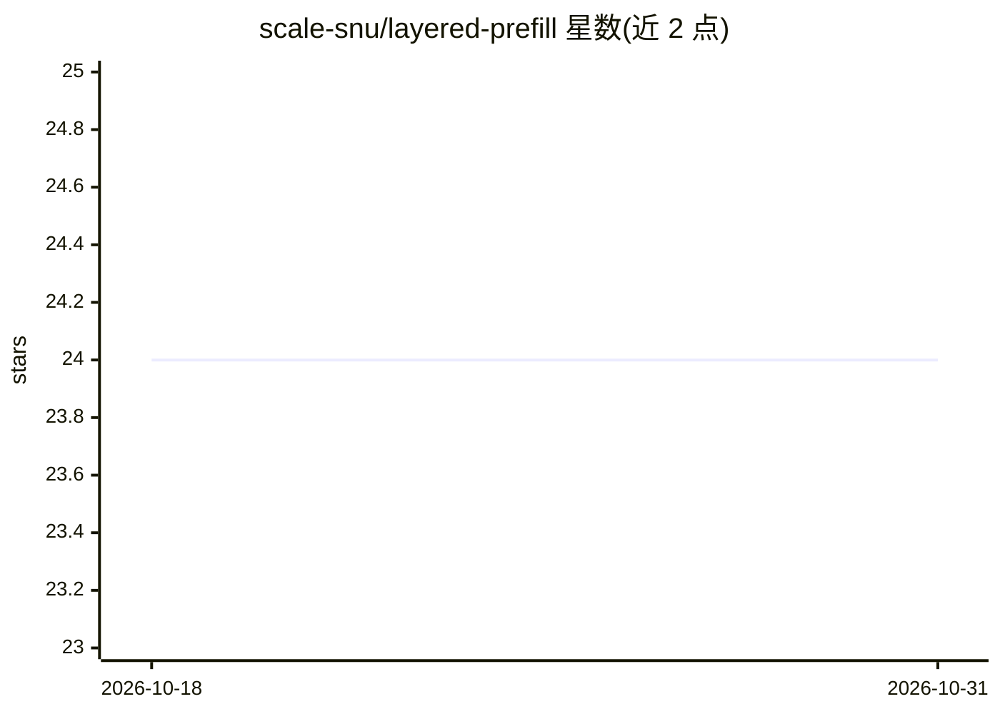

# scale-snu/layered-prefill

⭐ 24 · Python · MIT · 推送 2026-03-09 · [GitHub](https://github.com/scale-snu/layered-prefill) · 组织维护

**LLM 服务调度方法：按层推进 prefill，消除 MoE 权重冗余重载**

面向 LLM 推理服务（MoE 模型）的调度方法与实现：将调度轴从 token 改为层，模型按连续层组切分，每次迭代仅一个层组同时执行 prefill 与 decode，其余层组只跑 decode，从而避免 chunked prefill 中每个 chunk 重复遍历全栈导致的 MoE 专家权重反复重载。README 报告 TTFT、端到端延迟与每 token 能耗下降且 decode 不停顿（TBT 稳定）。基于 nanovllm 代码库运行，通过 conda 安装并编译 CUDA 环境，提供 API server 启动命令，并给出与 vLLM v0.10.2 的对比基准。

## 筛选速览

| 维度 | 判定 | 备注 |
|---|---|---|
| AI 角色 | `ai-ecosystem` | LLM/agent 周边工具 |
| 许可风险 | `permissive` | MIT |
| 部署形态 | `None` |  |
| 模型依赖 | — | README 未给出锁定关系 |
| 硬件要求 | — | 无带数字的原话,不猜 |
| 安装摩擦 | `high` | 编译与系统依赖俱全 |
| 成熟度 | — | 结构信号不足 |

## 能力要点

- 按层组推进 prefill，每迭代保持 decode 不停顿
- 消除 chunk 放大的 MoE 专家权重重复加载，降低片外带宽
- 方法与 chunking 正交，可叠加使用以安全增大 chunk 尺寸
- 提供与 vLLM v0.10.2 的可复现对比命令（Qwen3-30B-A3B，2x H100）

## 适用场景

- MoE 大模型服务中降低 TTFT 与端到端延迟
- 长提示词场景下减少专家权重重载与能耗
- 研究 LLM serving 调度策略的替代方案对比

## 场景标签

`推理引擎` · 领域:训练与推理

## 证据(README 行号)

> L3: Layered Prefill changes the scheduling axis from tokens to layers and removes redundant MoE weight reloads while kee
> L27: The model is partitioned into contiguous layer groups and prefill advances one group per iteration while every grou
> L113: Layered-prefill: TORCH_CUDA_ARCH_LIST="8.0;9.0" PATH=$PATH:$CONDA_PREFIX/nvvm/bin CUDA_HOME=$CONDA_PREFIX/targets/

## 星数曲线

2026-10-18 24 → 2026-10-31 24（+0）

---
*卡片 v1 · prompt 1.4 · 生成 2026-10-27 · 置信度 high · 依据 README sha `7739b167c22f` · [字段定义](../../DATASET.md)*
