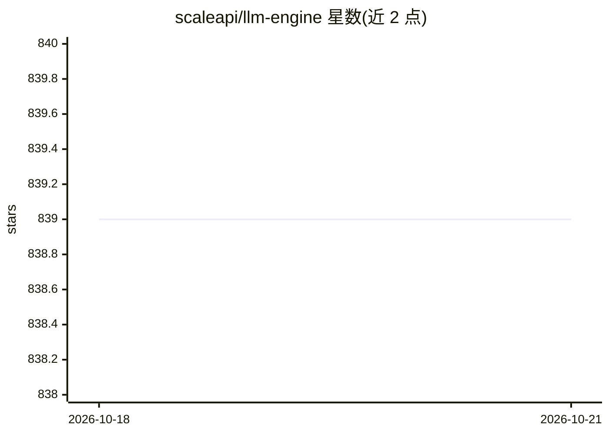

# scaleapi/llm-engine

⭐ — · [GitHub]() · 组织维护

**面向开发者的 LLM 微调与推理服务引擎**

Scale 公司开源的 LLM Engine，以 Python 库、CLI 和 Helm Chart 形式提供基础模型的微调与部署服务。支持 LLaMA、MPT、Falcon 等开源模型及任意 Hugging Face 模型的一键部署，可通过 Scale 托管版或 Kubernetes Helm Chart 在自有基础设施运行。提供流式响应、动态批处理推理 API 及自有数据微调。当前 K8s 自建文档标注为开发中，文档主要覆盖托管版客户端使用，需设置 SCALE_API_KEY。

## 筛选速览

| 维度 | 判定 | 备注 |
|---|---|---|
| AI 角色 | `ai-ecosystem` | LLM/agent 周边工具 |
| 许可风险 | `permissive` | — |
| 部署形态 | `library` | 以包/库形式分发 |
| 模型依赖 | — | README 未给出锁定关系 |
| 硬件要求 | — | 无带数字的原话,不猜 |
| 安装摩擦 | `low` | 无编译、无系统依赖或容器化 |
| 成熟度 | — | 结构信号不足 |

## 能力要点

- 支持 LLaMA/MPT/Falcon 等开源模型的部署与推理
- 自有数据微调基础模型
- 一条命令部署任意 Hugging Face 模型
- 提供流式响应与动态批处理的推理 API

## 适用场景

- 通过 Python 客户端调用托管 LLM 完成文本生成
- 在自有 Kubernetes 集群上微调并服务开源模型
- 用自有数据对开源基础模型做微调

## 场景标签

 · 领域:LLM 基础设施/微调与推理

## 证据(README 行号)

> L25: LLM Engine is a Python library, CLI, and Helm chart that provides
> L26: everything you need to serve and fine-tune foundation models, whether you use

## 星数曲线

2026-10-18 839 → 2026-10-21 839（+0）

---
*卡片 v1 · prompt 1.4 · 生成 2026-10-21 · 置信度 high · 依据 README sha `5bf74b111ab8` · [字段定义](../../DATASET.md)*
