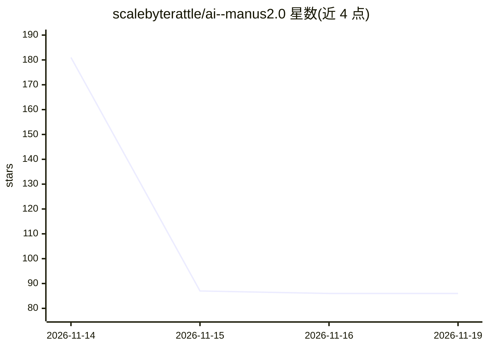

# scalebyterattle/ai--manus2.0

⭐ 86 · Apache-2.0 · 推送 2026-11-15 · [GitHub](https://github.com/scalebyterattle/ai--manus2.0) · 个人维护

**面向个人日常任务的自主 AI Agent：执行代码并控制浏览器**

README 自述为一个自主 AI 代理系统，代表用户编写并执行脚本、控制浏览器（导航网页、填写表单、抓取信息），完成多步骤任务，定位为家庭、学习与轻度办公场景的后台个人助理，无需编程背景。文中给出兼容性表（双核 CPU、4 GB RAM 起步）与六步上手流程（准备、配置、测试、细化、应用、维护）。注意：README 未提供任何实际的安装命令、代码入口或技术实现细节，仅有"Download Manus / PROMO2026"字样，可验证的技术内容有限。

## 筛选速览

| 维度 | 判定 | 备注 |
|---|---|---|
| AI 角色 | `ai-native` | 本体是模型或模型工具 |
| 许可风险 | `permissive` | Apache-2.0 |
| 部署形态 | `None` |  |
| 模型依赖 | — | README 未给出锁定关系 |
| 硬件要求 | — | 无带数字的原话,不猜 |
| 安装摩擦 | `low` | 无编译、无系统依赖或容器化 |
| 成熟度 | — | 结构信号不足 |

## 能力要点

- 自述支持自主执行代码与浏览器控制
- 自述可跨脚本与浏览器的多步骤任务
- 面向非开发者的小型任务自动化定位
- 给出最低/推荐硬件兼容性表（4 GB RAM 起步）

## 适用场景

- 让代理代为收集网页资料并整理摘要
- 自动填写重复表单、检查页面更新
- 运行小脚本做快速实验与计算

## 场景标签

`AI 助手` `浏览器自动化` · 领域:效率与自动化

## 证据(README 行号)

> L10: - **Autonomous Code Execution:** Manus AI agent runs code on its own to complete tasks, so you can focus on decisio
> L18: Manus is an autonomous AI agent designed to run code and control a browser on your behalf. Instead of acting like a

## 星数曲线

2026-11-14 181 → 2026-11-19 86（-95）

---
*卡片 v1 · prompt 1.4 · 生成 2026-11-17 · 置信度 mid · 依据 README sha `637da4fbcded` · [字段定义](../../DATASET.md)*
